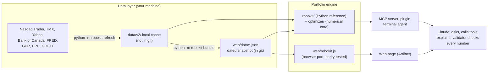

# Robo-Kit: an AI robo-advisor kit for Canadian and US ETFs

[](https://github.com/dylanguo1129/ai-robo-advisor/actions/workflows/ci.yml)

Robo-Kit is a do-it-yourself ETF portfolio lab built for the MMAI 823 (AI in Finance, Smith School of Business)
"AI Robo-Advisor Kit" team project. The web page (3.3.2, named **Penguru**, in the team's brand kit) is a guided conversation from the team's wireframes and
conversation script: it reads whatever you type (several answers at once, in any order) and says back what it
understood, asks a short self-check, explains each step at the depth you choose or that it infers (more numbers for
experienced investors, plain words and examples for beginners), answers questions at any point (with Claude if you connect it, else from its own notes), lets you name tickers and preferences, and builds
a mix of Canadian-listed ETFs with the reasons for each fund. The other surfaces (plugin, MCP server, terminal agent)
work as before: you tell it what you want in one sentence ("retirement, about 50k",
"qqq schd bito, 5k + 300/mo"), take a two-minute fixed self-check, pick a risk level and fill each asset class
with funds, and a transparent engine shows you what that mix does: dollars and whole units per fund, the one-year
range and the bad year, seven crisis replays in your own dollars, fees in dollars, goal and withdrawal odds, and the
same report for a one-fund alternative.

**Code computes every number; the language model only asks, calls tools and explains.** A validator rejects any
reply from Claude that contains a number or a ticker no tool produced.

> Educational tool, not a registered advisor or dealer. Results are hypothetical. It never tells anyone what to buy.

- **Universe:** every ETF you can buy in Canadian dollars in Canada (TSX, Cboe Canada) and every US-listed ETF:
  7,957 listings, of which 637 Canadian and 1,998 US pass the eligibility rules.
- **Data snapshot:** prices through 31 Aug 2026, listings and market context fetched 28 Sep 2026 (`web/data/`).
- **Engine:** v3.3.2. English only. The web page offers Canadian-listed ETFs; the other surfaces both markets.
- **How the optimizer works:** [optimizer/README.md](optimizer/README.md). **Reproduce our results:**
  [REPRODUCE.md](REPRODUCE.md) (offline; every published number is checked automatically).

---

## Contents

1. [Quick start](#quick-start)
2. [Reproduce our results](#reproduce-our-results)
3. [Ways to use it](#ways-to-use-it)
4. [Your own copy of the web page](#your-own-copy-of-the-web-page)
5. [Other AI tools and free Claude accounts](#other-ai-tools-and-free-claude-accounts)
6. [Sharing the web page: who gets the AI assistant](#sharing-the-web-page-who-gets-the-ai-assistant)
7. [How it works](#how-it-works)
8. [Repository layout](#repository-layout)
9. [Development](#development)
10. [Known limitations](#known-limitations)
11. [How this was built: the prompts](#how-this-was-built-the-prompts)
12. [Course context, AI use and licence](#course-context-ai-use-and-licence)

---

## Quick start

Requires Python 3.10+ (tested on 3.10 and 3.12) and, for the browser-engine tests, Node 18+.

```bash
git clone https://github.com/dylanguo1129/ai-robo-advisor.git
cd ai-robo-advisor
python -m venv .venv && source .venv/bin/activate        # Windows: .venv\Scripts\activate
pip install -r requirements-dev.txt && pip install -e . --no-deps
python -m robokit status                                  # data_source: "snapshot" on a fresh clone
python -m robokit build --market CA --level 3 --amount 25000
```

A fresh clone works immediately from the committed snapshot in `web/data/`; nothing needs downloading.
Run from the clone (editable install): `AGENT.md` and `web/data/` live at the repository root, outside the Python
packages, so a plain `pip install .` wheel is not supported.

To try the web page locally:

```bash
python scripts/serve_dev.py           # http://127.0.0.1:8765/index.html: the guided page without Claude (classic.html: the earlier page)
python scripts/make_mock_page.py      # optional: web/mock.html, a test harness where you play Claude from the
                                      # devtools console (window.__mock.view(), .call(name, args), .finish(text))
```

## Reproduce our results

The data every published number came from is committed (`data/replication/`), so the results can be re-run offline
and are checked against what we published, value by value. After the quick start:

```bash
python scripts/replicate.py tables       # 2 minutes: the optimizer tables of both reports (99 printed values)
python scripts/replicate.py snapshot     # 5 minutes: web/data/ rebuilt from the archived data, compared
python scripts/replicate.py evaluation   # a few minutes: part of the registered evaluation, at its own commit
```

`python scripts/replicate.py evaluation --full` re-runs the whole registered evaluation (hours). Use a full `git
clone` (the evaluation checks out the commit it ran on). [REPRODUCE.md](REPRODUCE.md) explains each check, what
"the same" means and where every published number comes from; the same checks run in CI on Linux. How the optimizer
reaches its numbers: [optimizer/README.md](optimizer/README.md).

## Ways to use it

| Way | Who runs Claude | What you need | Start |
|---|---|---|---|
| **Web page, your own copy** (a claude.ai Artifact) | Your own Claude plan: you own the copy | Pro, Max, Team or Enterprise; Claude Code; access to this repo | Clone, open in Claude Code, type `/publish-robo-kit` ([next section](#your-own-copy-of-the-web-page)) |
| **Web page, the owner's copy** | The viewer's own account, but the assistant only for the owner's Team / Enterprise organization ([sharing](#sharing-the-web-page-who-gets-the-ai-assistant)) | A Claude account and an invitation | [Robo-Kit artifact](https://claude.ai/artifact/8BA8T78qH17LF1v7Ss4qgu) (private; the owner shares it) |
| **Claude Code plugin** | Your own Claude Code session and model | Claude Code, Python deps installed, access to this repo | `/plugin marketplace add dylanguo1129/ai-robo-advisor` then `/plugin install robo-kit@robo-kit` |
| **MCP server** | Your own AI tool: Claude Desktop (any plan, Free included), Claude Code, Cursor, Gemini CLI, Antigravity, Codex | This repo, installed as above | `claude mcp add robokit -- python -m robokit.mcp_server` (run from the repo folder); other tools: [below](#other-ai-tools-and-free-claude-accounts) |
| **Terminal agent** | Your own `ANTHROPIC_API_KEY` | An API key | `python -m robokit chat --tier default` (`quick` = Haiku 4.5, `default` = Sonnet 5.5, `complex` = Opus 5.5, or `--model <id>`) |

The plugin bundles the MCP server, the guide skill (`skills/robo-kit/`) and a Stop hook (`hooks/check_reply.py`)
that re-checks every reply's numbers against the tool results. The MCP server exposes 15 read-only tools
(`get_questions`, `score_profile`, `scenario_cards`, `risk_ladder`, `reference_shelf`, `search_etfs`,
`etf_profile`, `compare_etfs`, `build_portfolio`, `compare_one_fund`, `plan_contribution`, `market_context`,
`explain_term`, `backtest_summary`, `data_status`) and the prompt `robo_kit_guide` (from [AGENT.md](AGENT.md)).
For Claude Desktop, add to `claude_desktop_config.json`, pointing at the Python inside the repo's `.venv`
(absolute path; on Windows `<path to this repo>\\.venv\\Scripts\\python.exe`):

```json
{ "mcpServers": { "robokit": { "command": "<path to this repo>/.venv/bin/python", "args": ["-m", "robokit.mcp_server"] } } }
```

## Your own copy of the web page

Anthropic lets the assistant run in a shared page only for its owner and the owner's Team or Enterprise organization
([next section](#sharing-the-web-page-who-gets-the-ai-assistant)), and documents no way to copy someone else's
Claude Code artifact. So each teammate who wants the assistant publishes **their own copy** from this repository: a
private artifact in their own claude.ai account. They are its owner, so the assistant runs on their own plan.

You need a Pro, Max, Team or Enterprise plan; Claude Code (the `claude` CLI, or the Code tab of the Claude desktop
app, version 1.13576.0 or later) signed in with `/login`, not an API key; Python 3; and read access to this
repository (the owner adds you).

```bash
git clone https://github.com/dylanguo1129/ai-robo-advisor.git
cd ai-robo-advisor
claude                       # or open this folder in the Code tab of the Claude desktop app
```

Then type `/publish-robo-kit`. Claude runs `python scripts/check_publish.py`, which checks the files listed in
`web/publish.json` against what the page loads, scans every value in the data files and summarises them. Claude then
reads the page code, publishes it and gives you your link. Publishing takes some of your Claude Code usage (Claude reads about 500 KB of page code), and
the assistant's replies count against your plan, never the owner's.

- **Updating:** `git pull`, then `/publish-robo-kit update` (same link). A copy never updates by itself.
- **Sharing:** artifacts that use Claude cannot be shared by public link. The data snapshot comes from public
  sources whose terms cover personal, non-commercial use ([data/README.md](data/README.md)).
- **How it works:** the command is `.claude/skills/publish-robo-kit/SKILL.md`; the published files are listed in
  `web/publish.json`, and `tests/test_publish_manifest.py` fails if the page loads a file that is not listed.

## Other AI tools and free Claude accounts

The web page's assistant needs a Claude plan (above). The same Robo-Kit tools also run as an MCP server on your own
computer, so any AI tool that can start a local MCP server can use them: the same 15 tools and the same numbers, with
that tool's model and plan. The conversation then happens in that tool instead of on the web page.

**One-time setup** (Git and Python 3.10 or later):

```bash
git clone https://github.com/dylanguo1129/ai-robo-advisor.git
cd ai-robo-advisor
python -m venv .venv && source .venv/bin/activate        # Windows: .venv\Scripts\activate
pip install -r requirements.txt && pip install -e . --no-deps
```

The server command is the full path of that Python followed by `-m robokit.mcp_server`, for example
`C:/Users/you/ai-robo-advisor/.venv/Scripts/python.exe -m robokit.mcp_server` on Windows (forward slashes work) or
`/Users/you/ai-robo-advisor/.venv/bin/python -m robokit.mcp_server` on macOS. It works from any folder. Tested: it
starts in under a second, and building a mix takes about 10 seconds.

| Tool | Plans (vendor docs, 2 Oct 2026) | Add the server |
|---|---|---|
| Claude Desktop | Local servers run on every Claude plan (Anthropic: "Desktop extensions are available to all users"); the config file below was not tried on a Free account | Settings > Developer > Edit Config opens `%APPDATA%\Claude\claude_desktop_config.json` (Windows) or `~/Library/Application Support/Claude/claude_desktop_config.json` (macOS); JSON below |
| Cursor (editor or CLI) | Cursor's pricing page lists MCP under the paid plans, not under the free Hobby plan | `~/.cursor/mcp.json`, or `.cursor/mcp.json` in this folder, JSON below; approve the server when Cursor asks |
| Gemini CLI | Free with a personal Google account (1,000 requests a day), or Google AI Pro / Ultra | `~/.gemini/settings.json`, JSON below; the folder must be trusted (`gemini trust`) |
| Antigravity (Google) | Every plan, free included (weekly quota) | `agy mcp add robokit -- <python> -m robokit.mcp_server` |
| Codex CLI, Codex IDE extension, ChatGPT desktop app | ChatGPT sign-in (OpenAI's pricing page lists every plan from Free up; the Codex README lists paid plans) or an API key | `codex mcp add robokit -- <python> -m robokit.mcp_server`, then add `tool_timeout_sec = 120` under `[mcp_servers.robokit]` in `~/.codex/config.toml` |

The JSON for Claude Desktop, Cursor and Gemini CLI, with your own path (merge it into the file if it already lists
servers). Windows:

```json
{ "mcpServers": { "robokit": { "command": "C:/Users/you/ai-robo-advisor/.venv/Scripts/python.exe", "args": ["-m", "robokit.mcp_server"] } } }
```

macOS or Linux:

```json
{ "mcpServers": { "robokit": { "command": "/Users/you/ai-robo-advisor/.venv/bin/python", "args": ["-m", "robokit.mcp_server"] } } }
```

Then start a chat in that tool, for example: *"Use the robokit tools and follow the Robo-Kit guide rules (AGENT.md in
the repository). I want to build an ETF mix: retirement, about 50k."* In Gemini CLI the guide is also the slash
command `/robo_kit_guide`. Gemini CLI and Codex add the server's built-in rules to the model's instructions by
themselves.

Limits of this route:
- No web page: you see the tool results as text and tables in your tool's chat.
- Only the web page and the Claude Code plugin (its Stop hook) check every number in a reply against the tool
  results. Other tools, and the bare MCP server in Claude Desktop or Claude Code, do not, so trust the tool results
  over the model's own wording.
- Web chat apps (claude.ai, chatgpt.com, gemini.google.com) cannot start a server on your computer.

**No AI at all:** run the page on your own computer, with everything except the assistant:
`python scripts/serve_dev.py`, then open http://127.0.0.1:8765/index.html. Or ask the owner for an invitation to the
shared page (needs a Claude account; no assistant).

## Sharing the web page: who gets the AI assistant

The page is published as a claude.ai Artifact from the files listed in `web/publish.json`. Everything except Claude's
answers runs inside the page itself: the conversation, typed answers, the page's own answers (glossary, FAQ, fund
facts, issuer holdings), the assessment, the mix, stress tests, projections, adjustments and the summary. Claude's
answers use the Artifact `sample` capability, which **runs Claude on the viewer's own account and usage**, never the
owner's. There is no API key and no setup: a viewer for whom Claude is available sees **Connect Claude for
reasoning** at the start of the conversation; the first connection asks them once to allow it. Viewers without it
get the page's own answers, and the advice redirect never depends on Claude.

Anthropic's sharing rules for artifacts that use Claude (help centre, "Share artifacts", checked 1 Oct 2026):

- "Artifacts that connect to your apps or use Claude can't use 'Anyone with the link.'" There is no public link.
- People you invite from outside your organization can open the page, but "Parts of the artifact that use Claude
  or your connectors don't work for them."
- "Everyone needs a Claude account. People without one can't open a shared artifact, even with the link."
- Email invites (beta) are available on Pro, Max, Team and Enterprise.
- Copying a shared artifact into your own account is documented only for legacy chat artifacts (made before
  16 Sep 2026); none is documented for artifacts published from Claude Code, which is what this page is.

So, in practice:

| Viewer | Opens the page | Non-AI features | AI assistant |
|---|---|---|---|
| The owner | yes | yes | yes, on the owner's plan |
| Member of the owner's Team / Enterprise organization | yes | yes | **yes, automatically on their own account** after one consent prompt |
| Anyone else invited by email (e.g. teammates on personal Pro / Max / Free accounts) | yes | yes | **no**: the page says the assistant is not available and everything else keeps working. On Pro or above they can publish their own copy |
| No Claude account / public link | no | – | – |

Teammates outside the owner's organization who want the assistant should **publish their own copy**
([above](#your-own-copy-of-the-web-page)). The **Claude Code plugin** and the **MCP server** from this repository are
the other route: same tools, same rules, their own model choice, in Claude Code or Claude Desktop instead of the page.

The data snapshot inside the page is built from public sources whose terms cover personal, non-commercial use (see
[data/README.md](data/README.md)); the page is a course prototype, not a commercial product.

## How it works



### Data layer

All data is fetched by scripts (`robokit/data/`), never typed in or downloaded by hand: ETF lists from Nasdaq Trader
and TMX, fees, sizes and monthly total-return prices from Yahoo Finance (via `yfinance`), rates and CPI from the Bank
of Canada and Yahoo, the high-yield spread from FRED, geopolitical risk (GPR) and policy uncertainty (EPU) indices,
and news tone from GDELT. `python -m robokit refresh` writes everything to a local cache (`data/v2/`, ignored by git)
and `python -m robokit bundle` compresses it into the committed snapshot `web/data/` that the page, the MCP server and
a fresh clone all use.

**Nothing refreshes automatically.** There is no scheduler, and the published page cannot fetch data (its sandbox
blocks outside requests). Updating means: `refresh` → `bundle` → `make check` → commit → republish the artifact.
Full catalogue, licences and limits: [data/README.md](data/README.md); field dictionary: [docs/DATA.md](docs/DATA.md).

### Portfolio engine

1. **Self-check → level.** Fixed questions score *capacity* (time horizon, lowered by "cushion" answers such as
   this money being most of your savings) and *tolerance* (four questions, three of them shown in your own dollars). The suggested
   level (1-5) is the lower of the two. It is a suggestion, not a ceiling: choosing higher first shows that level's
   bad year and crisis replays. Only "money needed within 2 years, all at once" (no stock mix) and "no emergency fund"
   or "a lot of high-interest debt" (cap at level 2) limit what is built.
2. **Level → target volatility.** Level L aims for L × 20% of the stock market's volatility (today about 10.7% in
   CAD and 13.8% in USD), so level 5 takes the stock market's full ups and downs and level 3 about 60% of them.
3. **Funds.** A written reference shelf picks one broad, cheap fund per asset class (score: size, trading volume,
   fee, history), with alternatives; you can swap funds, add your own picks (capped) or set your own weights.
4. **Weights.** Mean-variance optimisation, minimise (λ/2)·w′Σw − π′w with weights summing to 1, no shorting, at most
   50% per fund, caps per asset class (e.g. REITs and gold 10%, emerging markets 15%) and a cash cap by level.
   - **Expected returns π are equilibrium returns** implied by a written market anchor (60% stocks, 35% bonds,
     3% REITs, 2% gold): π = δ·Σ·w_anchor with δ = 2.5. Historical average returns are never used, because they
     are too noisy to optimise on.
   - **Covariance Σ** uses Ledoit-Wolf shrinkage on up to 15 years of monthly returns. Young funds are extended
     backwards with a closely correlated older fund.
   - **λ (risk aversion)** is calibrated on the mix you actually get (after resampling and after small positions are
     dropped, with the same random draws at every step), so each level lands within 0.005 percentage points of its
     target volatility, or the result says why not (a jump of the minimum-position rule, or a fund limit). The solver
     is accelerated projected gradient (FISTA) with an exact projection onto the capped simplex and fails closed
     without a convergence certificate.
   - **Resampling:** the whole fit is repeated on 200 bootstrap re-draws of history and the weights are averaged
     (with a 5-95% band per fund); positions under 2% are dropped.
5. **Report.** Planning returns from FP Canada's 2026 assumptions after each fund's fee; a 5,000-path bootstrap
   projection; seven historical crisis replays (2008, 2011, 2014-16, 2018, 2020, 2022, 2025); fees in dollars;
   rule-based checks; and market-context flags (VIX, credit spreads, GPR, EPU, trends, news) that are shown for
   context only and never move the weights.

6. **Orders and disclosure.** A rebalancer turns holdings and a cash flow into whole-unit orders: cash flows first,
   bands of min(2 points, 25% of target) traded back to 7/8 of the band, a minimum order of $50, and orders above 1% of
   a fund's daily traded value flagged. Every mix shows its NI 81-102 Appendix F risk rating. Suitability checks are
   opt-in; the level policy is unchanged.

**Evidence.** Version 3 was evaluated under a plan written before any of it ran, examined in eighteen rounds by
AI reviewers from other model families, and run from a committed protocol (one re-run for a disclosed bug fix). In Canada each level's
realised volatility over 2010-2026 was within a few percent of its target; in the US over 2019-2026 it was about a
third above. No Sharpe-ratio difference from the benchmarks was detected, and in simulation a static mix did slightly
better when the model's expected returns were wrong: the honest read is "close to its stated risk in Canada (the registered
reading is inconclusive), and fails safely", not "beats the market". How the optimizer works and why we chose it:
[optimizer/README.md](optimizer/README.md). The paper ([docs/paper](docs/paper)), every design decision with its source or test
([docs/DECISIONS.md](docs/DECISIONS.md)), the plan ([docs/RESEARCH_LOG.md](docs/RESEARCH_LOG.md) sections 9-11) and
the results ([output/v3/results.json](output/v3/results.json)) are in the repository.

## Repository layout

```
robokit/                 the engine (Python reference implementation)
  data/                  fetchers: listings.py, prices.py, context.py (macro, geopolitics, news)
  classify.py universe.py shelf.py history.py profile.py engine.py views.py cma.py
  projection.py stress.py signals.py explain.py glossary.py validate.py
  tools.py               the tool contract shared by every surface
  mcp_server.py agent.py bundle.py refresh.py backtest.py __main__.py (CLI)
optimizer/               the numerical core: shrinkage estimators, equilibrium returns, solver, resampling;
                         README.md: how the optimizer works, and why this method
web/                     the published page (files listed in web/publish.json): index.html, guide.js (screens and
                         flow), converse.js (typed text, answers without AI), kb.js (fixed wording), robokit.js
                         (engine port), engine.js, parse.js, validate.js, worker2.js, data/ (snapshot)
                         classic.html, app.js, strings.js, assistant.js, icons.js: the earlier page, kept for reference
                         dev only: dev_mock.js, test_*.mjs, test_profiles.json
tests/                   pytest suite; tests/ui: browser regression tests (opt-in: -m ui)
scripts/                 data fetch, back-tests, the registered evaluation, replicate.py (re-run and check our
                         results), v1 prototype, dev server, mock page, publish check
data/                    README.md (data catalogue) + v1 inputs; replication/: the archived data of record (see
                         REPRODUCE.md); the local cache data/v2/ is git-ignored
output/                  results of record: the registered v3 evaluation (output/v3/results.json), v1 and v2
                         back-tests (output/v2/backtest_v2_summary.json is used at runtime)
docs/                    METHOD, PRODUCT_SPEC, DATA, RESEARCH_LOG, VERIFICATION, AI_USE_LOG,
                         research/ (sourced research lanes), qa/ (persona tests and market research),
                         design/ (product and design system), archive/ (superseded plans)
AGENT.md                 how the assistant talks and what it may do (loaded by the MCP server, plugin and terminal
                         agent; the published page carries a condensed copy in web/guide.js, the classic page
                         another in web/assistant.js)
.claude-plugin/ skills/ hooks/ .mcp.json    Claude Code plugin packaging
.claude/skills/publish-robo-kit/             /publish-robo-kit: publish your own copy of the web page
.github/                 CI workflow and pull-request template
```

## Development

```bash
make setup      # pinned deps + editable install + pre-commit hooks
make check      # ruff lint + format check, pytest, node browser-engine tests
make test-ui    # browser regression tests (Playwright; CI runs them in their own job)
make format     # auto-fix lint and format
make data       # NETWORK: refresh the local cache and rebuild web/data/ (then review, test, republish)
make lock       # re-lock requirements*.txt from pyproject.toml (uv keeps existing pins; add --upgrade to move)
```

Without `make` (Windows), run the commands listed in the [Makefile](Makefile) directly.

| Check | Command | Result today |
|---|---|---|
| Python tests | `python -m pytest -q` | 681 passed with the local data cache (`python scripts/replicate.py data` unpacks it from the repository); on a fresh clone and in CI 593 pass and the 88 that need `data/v2/` (or the v1 price file) are skipped. The browser tests below are opt-in and deselected here |
| Browser regression tests | `python -m pytest -m ui tests/ui` (or `make test-ui`) | 147 tests in headless Chromium: 77 on the guided page (the conversation script, typed answers, the advice redirect, Claude connected through a stand-in, the edge cases of the Requirements Plan, the team's second feedback round, the demo rehearsal, the whole-repository review) and 70 on `web/classic.html` (with and without the assistant, the self-check, the mix, layout and accessibility). Needs Playwright and a Chromium-based browser (`python -m playwright install chromium`, or Edge or Chrome installed) |
| Browser engine vs Python | `node web/test_robokit.mjs` | 28 reference portfolios and 6 resampled cases (weights, calibration outcome, notes and checks), 400 self-check answer sets and the one-fund checks all match |
| Guided conversation | `node web/test_converse.mjs` | 624 checks: advice phrasings, the whole-message reader and its recording gate, depth (self-identified and inferred), the wording at three depths, the scoring rule against the engine, tickers, answers without AI, number provenance, the checks on Claude's replies |
| Input parser and no-AI router | `node web/test_parse.mjs` | 144 cases: amounts, first messages, and how a typed message is routed without the assistant |
| Chat layer | `node web/test_assistant.mjs` | 7 cases, with a scripted model: each card appears once per turn, including across the rewrite pass |
| v1 browser engine | `node web/test_engine.mjs` | 9 checks |
| Swap and request safety | `node web/test_safety.mjs` | 44 checks: refused swaps, slot rules and request validation in the browser engine |
| Published files | `python scripts/check_publish.py` | the 10 files in `web/publish.json` (plus the page) are exactly what the page loads, within the Artifact size limits; also run by pytest |
| Lint / format | `ruff check .`, `ruff format --check .` | clean |

Engineering conventions:

- **Reproducible environment:** loose ranges in `pyproject.toml`; exact, tested pins in `requirements.txt`
  (runtime) and `requirements-dev.txt` (dev), generated with `uv`.
- **Data out of git:** only the dated snapshot `web/data/`, two small v1 inputs, the issuers' MERs and top holdings
  of the reference funds (`data/issuer_mer.csv`, `data/fund_holdings.json`) and the archived data of record
  (`data/replication/`, for reproducing our results) are tracked; a pre-commit hook blocks raw vendor data in
  `data/v2/` and `data/raw/`.
- **Determinism:** fixed seeds for resampling (Python seed 0) and projections (seed 7); the data snapshot id
  (`00a560f4a6d3`, the same on the page, the CLI and the MCP server) and the engine version are written into every
  result. `python -m robokit bundle` refuses to run without the local data cache.
- **Single source of truth:** Python is the reference; the browser port must reproduce it
  (`web/test_robokit.mjs`), and `python -m robokit bundle` regenerates the reference cases.
- **CI:** lint, Python 3.10 and 3.12 tests, node tests and the browser regression tests on pushes to `main` and on every pull request
  (`.github/workflows/ci.yml`). Workflow and rules: [CONTRIBUTING.md](CONTRIBUTING.md).

## Known limitations

From the v3 evaluation (docs/paper, output/v3/results.json) and the audits, as of October 2026:

1. **US risk ran above target.** Over 2019-2026 the US levels' realised volatility was about a third above their
   targets (the Canadian levels were within a few percent over 2010-2026). A level's stated volatility is a long-run
   estimate, and recent years exceeded it.
2. **No proven edge.** No Sharpe-ratio difference from the benchmarks was detected after adjusting for multiple tests;
   in a simulation where the model's expected returns are wrong, a static stock-bond mix did slightly better.
   Resampling neither helped nor hurt. The honest read is "close to its stated risk in Canada, and fails safely", not
   "beats simple alternatives".
3. **Crisis replays start in 2008.** None covers the 2000-2002 bear market.
4. **US levels 2-3 do not see 2008 in their ranges.** BNDX starts in 2013 and its written stand-in (BWX, unhedged)
   correlates 0.68 with it, below the 0.80 the stand-in rule requires, so it is never used; for mixes holding BNDX the
   bad year and projections use history from July 2013 (the crisis replay itself still shows 2008).
5. **An own pick from the other market** (for example a US-listed fund in a Canadian mix) is built by Python and the
   MCP server, converted to the portfolio currency, but the web page carries only one market's funds and leaves it
   out with a note.
6. **Slot rules and fund labels.** The Canadian "Global bonds, hedged" slot holds a US-only fund (VBU, a CAD-hedged
   US aggregate index fund); the slot's rule accepts it (docs/research/e7e_shelf_audit.md). A fund swap must pass
   the slot's rule and a like-for-like label, so sector, factor, option- and futures-based, values-screened and
   single-country funds are refused, but actively managed bond funds and swap-based index funds that a slot's rule
   admits can still be swapped in. The labels that let a fund into the wrong slot were corrected after the run (the
   second bug hunt in docs/DECISIONS.md), and so were 37 currency-hedging labels in 3.0.2, among them the gold fund
   VALT, which the registered evaluation extended with unhedged gold although it is CAD-hedged
   (docs/research/v302_hedging_labels.md; its effect on the evaluation is in docs/RESEARCH_LOG.md section 13). In
   3.0.3 the team's separately built data layer (github.com/shreyajane23/robokit-data) cross-checked every Canadian
   label, and the region and leverage rules it showed wrong were fixed (docs/research/v303_crosscheck.md). Labels are
   still read from names by rules, so some remain wrong (docs/research/e7e_taxonomy.md lists known ones); hedging is
   read from the name, so a hedged unit with a plain name needs an issuer-sourced override.
7. **Large accounts.** On a 1,000,000 account, the largest orders in several Canadian funds exceed 1% of their average
   daily traded value; the rebalancer flags them.
8. **Level 5** is held by the fund limits a little below its volatility target (within half a point; the calibration
   reports it as out of reach). When a target is out of reach, the search moves risk aversion one way only, and since
   dropping small positions makes volatility jump, a slightly closer mix can exist on the other side. Near such a
   jump the two engines can also stop after a different number of evaluations (Python 30, the browser 23), and so
   at slightly different mixes; both report the jump.
9. **Fresh-clone Python uses rates one month older** than the web page (the snapshot loader drops the newest rate
   month). Do not run `bundle` without the local cache.
10. **Data:** survivor-only universe (no delisted funds); TMX and Yahoo endpoints are unofficial and for personal use;
   a per-ticker rate-limit failure inside a successful price chunk is not recorded; news is partly carried over from
   an earlier fetch.
11. **The page without the assistant reads messages with keyword rules** (`web/parse.js`, cases in
    `web/test_parse.mjs`). Unusual phrasings can get "Nothing matched"; the assistant handles free text.
12. **A phone held sideways with the largest text size** leaves little room above the composer for the self-check.
13. **Not advice.** In Canada, advice from an engine like this must be given by a registered portfolio manager with
    human oversight (CSA Staff Notice 31-342). Robo-Kit is a research and teaching tool.

## How this was built: the prompts

```text
Build Robo-Kit, a do-it-yourself ETF portfolio lab for the MMAI 823 "AI Robo-Advisor Kit" project
(brief: task 5 of the course brief; team outline: the shared Google Doc). Work in this repo. English only.

Deliverable: a claude.ai Artifact with a Google/ChatGPT-style landing page (one input box, a few chips, and a
docked tray that shows a working mix from the first second; no dashboard of drop-downs), plus the same engine as
a Python package with an MCP server and a Claude Code plugin.

Users: first-time and DIY investors in Canada and the US, and a non-expert grant panel. Sentences under 20 words,
dollars before percentages. Style: Wealthsimple (minimal, but complete).

Data: every ETF buyable in CAD on the TSX or Cboe Canada and every US-listed ETF; one market per mix. Sources:
Nasdaq Trader, TMX, Yahoo (yfinance), Bank of Canada, GPR, EPU, GDELT, all fetched by scripts with as-of stamps;
monthly total returns. These allow personal, non-commercial use; the page is a course prototype. The artifact
cannot fetch at runtime: bundle a dated snapshot under 16 MB; refresh by hand (refresh, bundle, republish).

Engine (code produces every number): equilibrium expected returns from a written market anchor (never
historical means), Ledoit-Wolf covariance, five levels calibrated to target volatility, guardrails, resampling
with 5-95% bands, seven named crisis replays, bootstrap projections. Python is the reference; the JavaScript
port must match it within 2e-3 on at least 10 reference cases.

Level policy (fixed now): suggested level = min(capacity, tolerance); it is a suggestion, not a ceiling. Going
above capacity first shows that level's bad year and crisis replays in the person's dollars, and the choice is
recorded. Only these gates cap the build: money needed within 2 years all at once (no stock mix); no emergency
fund or heavy high-interest debt (level 2). Re-evaluate at once when an answer changes and post a one-line note.

Onboarding invariants: fixed self-check items as tappable cards, one live card at a time, answers editable in
place; parse the first message once (amount, monthly flow, goal, tickers); no duplicate cards; every automatic
change posts a note; every "bad year" or "8 in 10" figure uses one basis and says so. The page works fully
without AI.

AI: the in-page Claude uses the Artifact `sample` capability (viewer's own account; tiers Quick/Standard/Deep).
Rules live in AGENT.md: AI disclosure first; never "your portfolio" or "I recommend". A validator rejects any
number or ticker not in this turn's tool results and triggers one rewrite. Note that artifacts using Claude
work only for the owner and the owner's Team/Enterprise organization (no public link); everyone else uses the
plugin, MCP server or CLI. Document this in the README.

Out of scope: accounts, orders, tax advice, single stocks, forecasts from news (news is context only).

Done means all of these pass: pytest with invariants (weights sum to 1, caps hold, volatility rises with level);
node parity and parser tests; seven persona walkthroughs (novice, level-5 seeker, DIY, US phone user at 375 px,
retiree withdrawing, sceptical analyst, keyboard/screen-reader user) with zero silent changes, zero duplicate
cards and one figure per label; WCAG AA contrast, focus management and no horizontal scroll at 375 px with 200%
text; a README (install, run, refresh, share), an AI-use log with these prompts, and VERIFICATION.md.

Process: write the plan as a checklist first, build in vertical slices and run the tests after each slice. Ask
me only to pick between design directions, or before changing the level policy.
```

## Course context, AI use and licence

- Course: MMAI 823 AI in Finance, Smith School of Business, Queen's University. The course allows generative AI
  with citation; this project's AI use is recorded in [docs/AI_USE_LOG.md](docs/AI_USE_LOG.md), and the checks
  that were run are in [docs/VERIFICATION.md](docs/VERIFICATION.md).
- Code: MIT licence ([LICENSE](LICENSE)). Market data and the derived snapshot remain under their providers' terms
  ([data/README.md](data/README.md)); the repository is public for the course and includes the derived snapshot for
  non-commercial, educational use.
- The original v1 prototype (a 20-ETF optimizer with three risk-aversion settings) lives on in `optimizer/`,
  `scripts/run_prototype.py`, `scripts/run_robustness.py` and `output/`; see [docs/METHOD.md](docs/METHOD.md).
