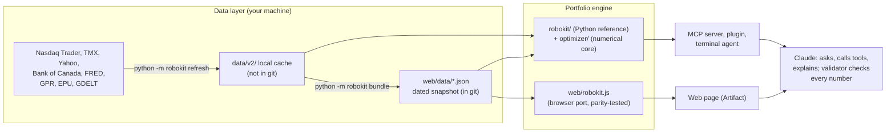

# Robo-Kit: an AI robo-advisor kit for Canadian and US ETFs

[](https://github.com/dylanguo1129/ai-robo-advisor/actions/workflows/ci.yml)

Robo-Kit is a do-it-yourself ETF portfolio lab built for the MMAI 823 (AI in Finance, Smith School of Business)
"AI Robo-Advisor Kit" team project. You tell it what you want in one sentence ("retirement, about 50k",
"qqq schd bito, 5k + 300/mo"), take a two-minute fixed self-check, pick a risk level and fill each asset class
with funds, and a transparent engine shows you what that mix does: dollars and whole units per fund, the one-year
range and the bad year, seven crisis replays in your own dollars, fees in dollars, goal and withdrawal odds, and the
same report for a one-fund alternative.

**Code computes every number; the language model only asks, calls tools and explains.** A validator rejects any
reply from Claude that contains a number or a ticker no tool produced.

> Educational tool, not a registered advisor or dealer. Results are hypothetical. It never tells anyone what to buy.

- **Universe:** every ETF you can buy in Canadian dollars in Canada (TSX, Cboe Canada) and every US-listed ETF:
  7,957 listings, of which 637 Canadian and 1,973 US pass the eligibility rules.
- **Data snapshot:** prices through 31 Aug 2026, listings and market context fetched 28 Sep 2026 (`web/data/`).
- **Engine:** v2.2.0. English only.

---

## Contents

1. [Quick start](#quick-start)
2. [Four ways to use it](#four-ways-to-use-it)
3. [Sharing the web page: who gets the AI assistant](#sharing-the-web-page-who-gets-the-ai-assistant)
4. [How it works](#how-it-works)
5. [Repository layout](#repository-layout)
6. [Development](#development)
7. [Known limitations](#known-limitations)
8. [How this was built: the prompts](#how-this-was-built-the-prompts)
9. [Course context, AI use and licence](#course-context-ai-use-and-licence)

---

## Quick start

Requires Python 3.10+ (tested on 3.10 and 3.12) and, for the browser-engine tests, Node 18+.

```bash
git clone https://github.com/dylanguo1129/ai-robo-advisor.git
cd ai-robo-advisor
python -m venv .venv && source .venv/bin/activate        # Windows: .venv\Scripts\activate
pip install -r requirements-dev.txt && pip install -e . --no-deps
python -m robokit status                                  # data_source: "snapshot" on a fresh clone
python -m robokit build --market CA --level 3 --amount 25000
```

A fresh clone works immediately from the committed snapshot in `web/data/`; nothing needs downloading.
Run from the clone (editable install): `AGENT.md` and `web/data/` live at the repository root, outside the Python
packages, so a plain `pip install .` wheel is not supported.

To try the web page locally:

```bash
python scripts/serve_dev.py           # http://127.0.0.1:8765/index.html: the full page without the AI assistant
python scripts/make_mock_page.py      # optional: web/mock.html, a test harness where you play Claude from the
                                      # devtools console (window.__mock.view(), .call(name, args), .finish(text))
```

## Four ways to use it

| Way | Who runs Claude | What you need | Start |
|---|---|---|---|
| **Web page** (a claude.ai Artifact) | The viewer's own Claude account, where Anthropic allows it (next section) | A Claude account and an invitation | [Robo-Kit artifact](https://claude.ai/artifact/8BA8T78qH17LF1v7Ss4qgu) (private; the owner shares it) |
| **Claude Code plugin** | Your own Claude Code session and model | Claude Code, Python deps installed, access to this repo | `/plugin marketplace add dylanguo1129/ai-robo-advisor` then `/plugin install robo-kit@robo-kit` |
| **MCP server** | Your own Claude Desktop / Claude Code | This repo, installed as above | `claude mcp add robokit -- python -m robokit.mcp_server` (run from the repo folder) |
| **Terminal agent** | Your own `ANTHROPIC_API_KEY` | An API key | `python -m robokit chat --tier default` (`quick` = Haiku 4.5, `default` = Sonnet 5.5, `complex` = Opus 5.5, or `--model <id>`) |

The plugin bundles the MCP server, the guide skill (`skills/robo-kit/`) and a Stop hook (`hooks/check_reply.py`)
that re-checks every reply's numbers against the tool results. The MCP server exposes 15 read-only tools
(`get_questions`, `score_profile`, `scenario_cards`, `risk_ladder`, `reference_shelf`, `search_etfs`,
`etf_profile`, `compare_etfs`, `build_portfolio`, `compare_one_fund`, `plan_contribution`, `market_context`,
`explain_term`, `backtest_summary`, `data_status`) and the prompt `robo_kit_guide` (from [AGENT.md](AGENT.md)).
For Claude Desktop, add to `claude_desktop_config.json`, pointing at the Python inside the repo's `.venv`
(absolute path; on Windows `<path to this repo>\\.venv\\Scripts\\python.exe`):

```json
{ "mcpServers": { "robokit": { "command": "<path to this repo>/.venv/bin/python", "args": ["-m", "robokit.mcp_server"] } } }
```

## Sharing the web page: who gets the AI assistant

The page is published as a claude.ai Artifact from the files in `web/`. Everything except the chat runs inside the
page itself: search, the self-check, the level ladder, the mix report, stress tests and projections. The chat uses
the Artifact `sample` capability, which **runs Claude on the viewer's own account and usage**, never the owner's.
There is no API key and no setup: the first time a viewer sends a message, Claude asks them once to allow it, and the
viewer picks Quick / Standard / Deep under **Assistant** (a viewer whose plan lacks that tier gets the nearest one).

Anthropic's sharing rules for artifacts that use Claude (help centre, "Publish and share artifacts", checked
30 Sep 2026):

- "Artifacts that connect to your apps or use Claude can't use 'Anyone with the link.'" There is no public link.
- People you invite from outside your organization can open the page, but "Parts of the artifact that use Claude
  or your connectors don't work for them."
- "Everyone needs a Claude account. People without one can't open a shared artifact, even with the link."
- Email invites (beta) are available on Pro, Max, Team and Enterprise.

So, in practice:

| Viewer | Opens the page | Non-AI features | AI assistant |
|---|---|---|---|
| The owner | yes | yes | yes, on the owner's plan |
| Member of the owner's Team / Enterprise organization | yes | yes | **yes, automatically on their own account** after one consent prompt |
| Anyone else invited by email (e.g. teammates on personal Pro / Max / Free accounts) | yes | yes | **no**: the page says the assistant is not available and everything else keeps working |
| No Claude account / public link | no | – | – |

Teammates outside the owner's organization who want the AI guide on their own Claude account should use the
**Claude Code plugin** or the **MCP server** from this repository: same tools, same rules, their own model choice.

The data snapshot inside the page is built from sources licensed for personal use (see [data/README.md](data/README.md)),
which is one more reason to keep the page shared only with the team.

## How it works



### Data layer

All data is fetched by scripts (`robokit/data/`), never typed in or downloaded by hand: ETF lists from Nasdaq Trader
and TMX, fees, sizes and monthly total-return prices from Yahoo Finance (via `yfinance`), rates and CPI from the Bank
of Canada and Yahoo, the high-yield spread from FRED, geopolitical risk (GPR) and policy uncertainty (EPU) indices,
and news tone from GDELT. `python -m robokit refresh` writes everything to a local cache (`data/v2/`, ignored by git)
and `python -m robokit bundle` compresses it into the committed snapshot `web/data/` that the page, the MCP server and
a fresh clone all use.

**Nothing refreshes automatically.** There is no scheduler, and the published page cannot fetch data (its sandbox
blocks outside requests). Updating means: `refresh` → `bundle` → `make check` → commit → republish the artifact.
Full catalogue, licences and limits: [data/README.md](data/README.md); field dictionary: [docs/DATA.md](docs/DATA.md).

### Portfolio engine

1. **Self-check → level.** Fixed questions score *capacity* (time horizon, lowered by "cushion" answers such as
   this money being most of your savings) and *tolerance* (four questions, three of them shown in your own dollars). The suggested
   level (1-5) is the lower of the two. It is a suggestion, not a ceiling: choosing higher first shows that level's
   bad year and crisis replays. Only "money needed within 2 years, all at once" (no stock mix) and "no emergency fund"
   or "a lot of high-interest debt" (cap at level 2) limit what is built.
2. **Level → target volatility.** Level L aims for L × 20% of the stock market's volatility (today about 10.7% in
   CAD and 13.8% in USD), so level 5 takes the stock market's full ups and downs and level 3 about 60% of them.
3. **Funds.** A written reference shelf picks one broad, cheap fund per asset class (score: size, trading volume,
   fee, history), with alternatives; you can swap funds, add your own picks (capped) or set your own weights.
4. **Weights.** Mean-variance optimisation, minimise (λ/2)·w′Σw − π′w with weights summing to 1, no shorting, at most
   50% per fund, caps per asset class (e.g. REITs and gold 10%, emerging markets 15%) and a cash cap by level.
   - **Expected returns π are equilibrium returns** implied by a written market anchor (60% stocks, 35% bonds,
     3% REITs, 2% gold): π = δ·Σ·w_anchor with δ = 2.5. Historical average returns are never used, because they
     are too noisy to optimise on.
   - **Covariance Σ** uses Ledoit-Wolf shrinkage on up to 15 years of monthly returns. Young funds are extended
     backwards with a closely correlated older fund.
   - **λ (risk aversion)** is solved for so the mix hits the level's target volatility. The solver is accelerated
     projected gradient (FISTA) with an exact projection onto the capped simplex.
   - **Resampling:** the whole fit is repeated on 200 bootstrap re-draws of history and the weights are averaged
     (with a 5-95% band per fund); positions under 2% are dropped.
5. **Report.** Planning returns from FP Canada's 2026 assumptions after each fund's fee; a 2,000-path bootstrap
   projection; seven historical crisis replays (2008, 2011, 2014-16, 2018, 2020, 2022, 2025); fees in dollars;
   rule-based checks; and market-context flags (VIX, credit spreads, GPR, EPU, trends, news) that are shown for
   context only and never move the weights.

Pre-registered back-tests after costs found no statistically significant edge over a static mix of the same funds
(and in the US the textbook sample-mean optimizer did better at level 3); the honest read is "transparent and
well-behaved", not "beats the market". Method and evidence:
[docs/METHOD.md](docs/METHOD.md), [docs/PRODUCT_SPEC.md](docs/PRODUCT_SPEC.md) section 7,
[docs/RESEARCH_LOG.md](docs/RESEARCH_LOG.md).

## Repository layout

```
robokit/                 v2 engine (Python reference implementation)
  data/                  fetchers: listings.py, prices.py, context.py (macro, geopolitics, news)
  classify.py universe.py shelf.py history.py profile.py engine.py views.py cma.py
  projection.py stress.py signals.py explain.py glossary.py validate.py
  tools.py               the tool contract shared by every surface
  mcp_server.py agent.py bundle.py refresh.py backtest.py __main__.py (CLI)
optimizer/               v1 numerical core still used by v2: shrinkage estimators, equilibrium returns, solvers
web/                     the published page: index.html, app.js, strings.js, assistant.js, robokit.js (engine port),
                         engine.js, parse.js, validate.js, icons.js, worker2.js, data/ (snapshot)
                         dev only: dev_mock.js, test_*.mjs, test_profiles.json
tests/                   pytest suite
scripts/                 data fetch, back-tests, v1 prototype, dev server, mock page
data/                    README.md (data catalogue) + v1 inputs; the local cache data/v2/ is git-ignored
output/                  results of record: v1 and v2 back-tests (output/v2/backtest_v2_summary.json is used at runtime)
docs/                    METHOD, PRODUCT_SPEC, DATA, RESEARCH_LOG, VERIFICATION, AI_USE_LOG,
                         research/ (sourced research lanes), qa/ (persona tests and market research),
                         design/ (product and design system), archive/ (superseded plans)
AGENT.md                 how the assistant talks and what it may do (loaded by the MCP server, plugin and terminal
                         agent; the web page carries a condensed copy in web/assistant.js)
.claude-plugin/ skills/ hooks/ .mcp.json    Claude Code plugin packaging
.github/                 CI workflow and pull-request template
```

## Development

```bash
make setup      # pinned deps + editable install + pre-commit hooks
make check      # ruff lint + format check, pytest, node browser-engine tests (what CI runs)
make format     # auto-fix lint and format
make data       # NETWORK: refresh the local cache and rebuild web/data/ (then review, test, republish)
make lock       # re-lock requirements*.txt from pyproject.toml (uv keeps existing pins; add --upgrade to move)
```

Without `make` (Windows), run the commands listed in the [Makefile](Makefile) directly.

| Check | Command | Result today |
|---|---|---|
| Python tests | `python -m pytest -q` | 120 passed with the local data cache; on a fresh clone and in CI 103 pass and 17 are skipped (16 engine tests need `data/v2/`, one v1 test needs `data/prices_daily_adjclose.csv`) |
| Browser engine vs Python | `node web/test_robokit.mjs` | 13 reference portfolios, 400 self-check answer sets, one-fund and resampled checks all match |
| Input parser | `node web/test_parse.mjs` | 25 cases |
| v1 browser engine | `node web/test_engine.mjs` | 11 checks |
| Lint / format | `ruff check .`, `ruff format --check .` | clean |

Engineering conventions:

- **Reproducible environment:** loose ranges in `pyproject.toml`; exact, tested pins in `requirements.txt`
  (runtime) and `requirements-dev.txt` (dev), generated with `uv`.
- **Data out of git:** only the dated snapshot `web/data/` and two small v1 inputs are tracked; a pre-commit hook
  blocks raw vendor data.
- **Determinism:** fixed seeds for resampling (Python seed 0) and projections (seed 7); the data snapshot id
  (`00a560f4a6d3`, the same on the page, the CLI and the MCP server) and the engine version are written into every
  result. `python -m robokit bundle` refuses to run without the local data cache.
- **Single source of truth:** Python is the reference; the browser port must reproduce it
  (`web/test_robokit.mjs`), and `python -m robokit bundle` regenerates the reference cases.
- **CI:** lint, Python 3.10 and 3.12 tests and node tests on pushes to `main` and on every pull request
  (`.github/workflows/ci.yml`). Workflow and rules: [CONTRIBUTING.md](CONTRIBUTING.md).

## Known limitations

Found during the 30 Sep 2026 audit and not yet fixed:

1. **US levels 2-3 do not see 2008 in their ranges.** The international bond fund BNDX starts in 2013 and its only
   stand-in correlates too weakly (0.68 < 0.80), so for US mixes holding BNDX the bad year and projections use
   history from July 2013, although the page says ranges include 2008 (the crisis replay itself still shows 2008).
2. **Chat and MCP fund swaps are too permissive.** The page's own menu limits a swap to the asset class's
   candidates, but the chat tool and `build_portfolio` accept any eligible fund in a core slot (e.g. a crypto ETF).
3. **Parity gap:** the Black-Litterman "view" reference case names IAUM, which is no longer the default gold fund
   (GLDM is), so the view is not applied and that path is not parity-tested; resampled weights differ slightly between Python and the browser (different
   random-number generators).
4. **Fresh-clone Python uses rates one month older** than the web page (the snapshot loader drops the newest
   rate month). Do not run `bundle` without the local cache.
5. **Data:** survivor-only universe (no delisted funds); TMX and Yahoo endpoints are unofficial; a per-ticker
   rate-limit failure inside a successful price chunk is not recorded; news is partly carried over from an earlier
   fetch.
6. **Level 5** is close to a corner solution and lands slightly below its volatility target after resampling.

## How this was built: the prompts

```text
Build Robo-Kit, a do-it-yourself ETF portfolio lab for the MMAI 823 "AI Robo-Advisor Kit" project
(brief: task 5 of the course brief; team outline: the shared Google Doc). Work in this repo. English only.

Deliverable: a claude.ai Artifact with a Google/ChatGPT-style landing page (one input box, a few chips, and a
docked tray that shows a working mix from the first second; no dashboard of drop-downs), plus the same engine as
a Python package with an MCP server and a Claude Code plugin.

Users: first-time and DIY investors in Canada and the US, and a non-expert grant panel. Sentences under 20 words,
dollars before percentages. Style: Wealthsimple (minimal, but complete).

Data: every ETF buyable in CAD on the TSX or Cboe Canada and every US-listed ETF; one market per mix. Sources:
Nasdaq Trader, TMX, Yahoo (yfinance), Bank of Canada, GPR, EPU, GDELT, all fetched by scripts with as-of stamps;
monthly total returns. These allow personal use only, so the page stays private or team-shared. The artifact
cannot fetch at runtime: bundle a dated snapshot under 16 MB; refresh by hand (refresh, bundle, republish).

Engine (code produces every number): equilibrium expected returns from a written market anchor (never
historical means), Ledoit-Wolf covariance, five levels calibrated to target volatility, guardrails, resampling
with 5-95% bands, seven named crisis replays, bootstrap projections. Python is the reference; the JavaScript
port must match it within 2e-3 on at least 10 reference cases.

Level policy (fixed now): suggested level = min(capacity, tolerance); it is a suggestion, not a ceiling. Going
above capacity first shows that level's bad year and crisis replays in the person's dollars, and the choice is
recorded. Only these gates cap the build: money needed within 2 years all at once (no stock mix); no emergency
fund or heavy high-interest debt (level 2). Re-evaluate at once when an answer changes and post a one-line note.

Onboarding invariants: fixed self-check items as tappable cards, one live card at a time, answers editable in
place; parse the first message once (amount, monthly flow, goal, tickers); no duplicate cards; every automatic
change posts a note; every "bad year" or "8 in 10" figure uses one basis and says so. The page works fully
without AI.

AI: the in-page Claude uses the Artifact `sample` capability (viewer's own account; tiers Quick/Standard/Deep).
Rules live in AGENT.md: AI disclosure first; never "your portfolio" or "I recommend". A validator rejects any
number or ticker not in this turn's tool results and triggers one rewrite. Note that artifacts using Claude
work only for the owner and the owner's Team/Enterprise organization (no public link); everyone else uses the
plugin, MCP server or CLI. Document this in the README.

Out of scope: accounts, orders, tax advice, single stocks, forecasts from news (news is context only).

Done means all of these pass: pytest with invariants (weights sum to 1, caps hold, volatility rises with level);
node parity and parser tests; seven persona walkthroughs (novice, level-5 seeker, DIY, US phone user at 375 px,
retiree withdrawing, sceptical analyst, keyboard/screen-reader user) with zero silent changes, zero duplicate
cards and one figure per label; WCAG AA contrast, focus management and no horizontal scroll at 375 px with 200%
text; a README (install, run, refresh, share), an AI-use log with these prompts, and VERIFICATION.md.

Process: write the plan as a checklist first, build in vertical slices and run the tests after each slice. Ask
me only to pick between design directions, or before changing the level policy.
```

## Course context, AI use and licence

- Course: MMAI 823 AI in Finance, Smith School of Business, Queen's University. The course allows generative AI
  with citation; this project's AI use is recorded in [docs/AI_USE_LOG.md](docs/AI_USE_LOG.md), and the checks
  that were run are in [docs/VERIFICATION.md](docs/VERIFICATION.md).
- Code: MIT licence ([LICENSE](LICENSE)). Market data and the derived snapshot remain under their providers' terms
  ([data/README.md](data/README.md)); the repository and the web page are private to the team.
- The original v1 prototype (a 20-ETF optimizer with three risk-aversion settings) lives on in `optimizer/`,
  `scripts/run_prototype.py`, `scripts/run_robustness.py` and `output/`; see [docs/METHOD.md](docs/METHOD.md).
