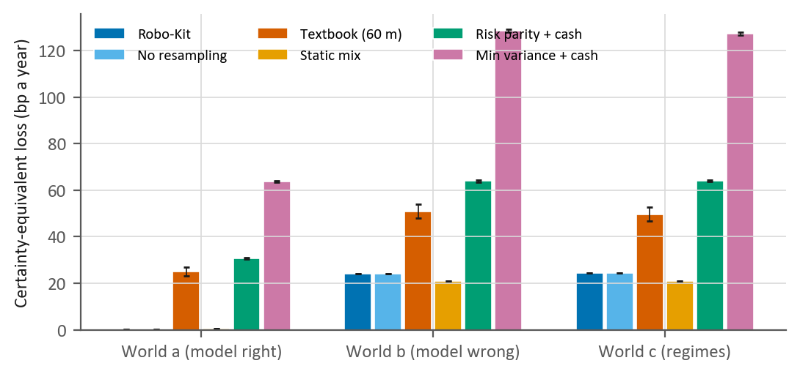
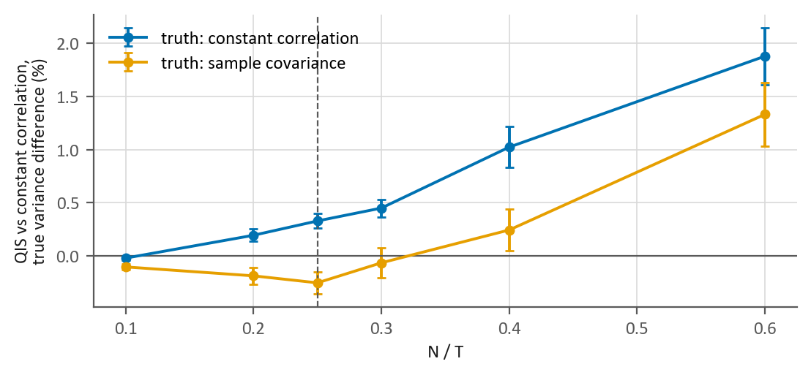
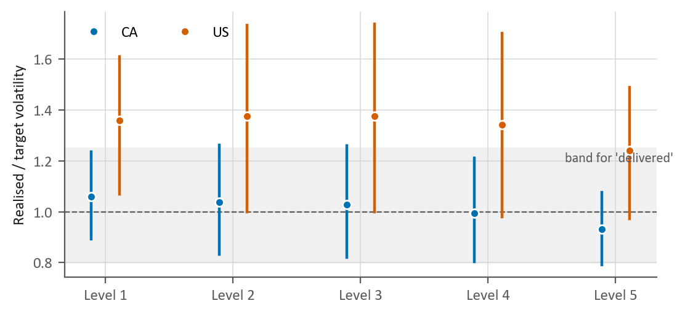
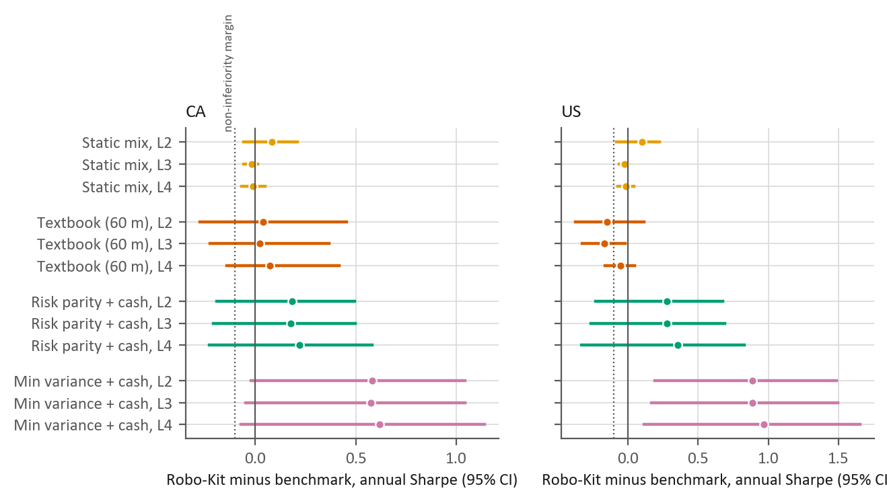
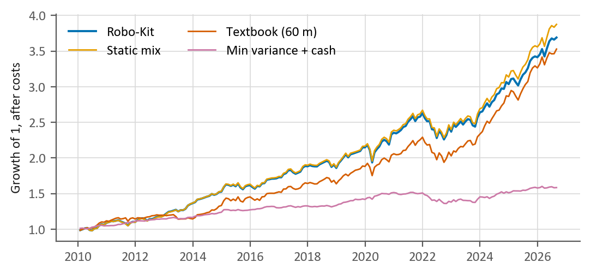

% Robo-Kit v3: a risk-calibrated, resampled mean-variance engine and its pre-registered evaluation
% Design, proofs and the results of a registered run, for Canadian and US investors
% Robo-Kit team · MMAI 823, AI in Finance · October 2026

# Abstract

Robo-Kit is an open-source portfolio engine for Canadian and US exchange-traded funds. It solves a long-only mean-variance problem on the equilibrium returns of a written policy mix, with shrunk covariances, averages the weights over resampled histories, and calibrates each client risk level, a volatility target, on the mix the client actually receives. Every design decision is tied to a source, a proof or a test. The evaluation was fixed in advance and examined before it ran by AI reviewers from other model families. In a simulation with a known truth, the engine comes within {{E3.summary.a.3.180.robokit.loss_bp|f1}} basis points a year of the best constrained portfolio when its model is right; when its expected returns are wrong it loses about {{E3.summary.b.3.180.robokit.loss_bp|f0}} basis points a year, about {{derived.e3.b.static_mix_advantage|f1}} more than a static stock-bond mix, and resampling makes no difference. Over {{E1.CA.strategies.robokit.3.months|int}} months in Canada, realised volatility was {{E1.CA.risk_delivery.primary.2.ratio|f2}}, {{E1.CA.risk_delivery.primary.3.ratio|f2}} and {{E1.CA.risk_delivery.primary.4.ratio|f2}} times target at the three main levels, but two of the simultaneous intervals reach just past the registered band, so the reading is "inconclusive"; no Sharpe-ratio difference from four benchmarks survived adjustment for multiple tests. In the US ({{E1.US.strategies.robokit.3.months|int}} months, exploratory) realised risk ran about a third above target.

# 1. Introduction

A robo-adviser turns a few answers about a client into a portfolio. Most of what makes that portfolio good or bad happens where the client never looks: how expected returns and risks are estimated, how a risk level becomes a portfolio, and what happens between the optimum and the orders. Commercial robo-advisers rarely describe these methods (Beketov, Lehmann and Wittke 2018). Robo-Kit was built in the open to show one way to do it, for Canadian and US exchange-traded funds, and this paper is its full account.

Mean-variance optimisation magnifies the errors in its estimated inputs (Michaud 1989; Chopra and Ziemba 1993). The engine answers with one tool from each family the literature offers (Section 2): shrinkage of the inputs, constraints on the solution, and averaging over resampled inputs. Version 3 adds two things. First, a calibration that makes each risk level hit its stated volatility for the mix the client receives, after resampling and after small positions are dropped, rather than for an intermediate solution. Second, an implementation layer: a rebalancer that turns weights into orders, the regulator's risk rating of every mix, and opt-in suitability checks.

The evidence comes in three forms. A register published with the code (docs/DECISIONS.md) ties each design decision to a source, a proof or a test, and says which decisions are policy. Three propositions the engine relies on are proved (Section 4.12). And an evaluation in eight parts (Section 5) was written down before any of it ran, examined in eighteen rounds by AI reviewers from other model families, briefed to question it as a demanding professor would, and run from committed code.

The main findings:
- **Simulation.** When its model is right the engine is close to the best portfolio the constraints allow. When its expected returns are wrong, the prior decides most of the loss: a static stock-bond mix lost slightly less, and resampling made no difference.
- **Risk in Canada.** Over {{E1.CA.strategies.robokit.3.months|int}} months each main level's realised volatility was within a few percent of its target, but the registered reading is "inconclusive", because the rule asks more than point estimates.
- **Risk in the US.** Over {{E1.US.strategies.robokit.3.months|int}} months realised risk was about a third above target, the clearest negative result.
- **Return.** No Sharpe-ratio comparison was conclusive after adjustment, as the power statement written before the run expected; in Canada the engine was shown not worse than a static mix by more than 0.10 at two of three levels.
- **What v3 added.** The calibration closed the gap between the model's volatility and the target, as designed, but did not move realised risk; the rebalancing bands cost about two-thirds of monthly rebalancing.
- **Gaps.** No crisis replay covers the 2000-2002 bear market, and an audit after the run found the fund-swap gate too permissive (fixed, outside the evaluated path). One pre-registered rule raised the projection paths from 2,000 to {{locked_defaults.projection_paths|int}}.

Section 2 reviews the literature, Section 3 the data, Section 4 the method, Section 5 the evaluation design and its examination, Section 6 the results, Section 7 the limitations and Section 8 concludes.

# 2. Related literature

**Estimation error.** Mean-variance optimisation is an "estimation-error maximiser" (Michaud 1989). Errors in means matter about ten times more than errors in variances (Chopra and Ziemba 1993), and on short samples the plug-in portfolio can underperform naive diversification (DeMiguel, Garlappi and Uppal 2009), although that comparison depends on how the alternatives are specified (Kritzman, Page and Turkington 2010). The responses fall into three families.

**Shrinking the inputs.** For covariances, linear shrinkage toward a structured target (Ledoit and Wolf 2004) and, when the number of assets is large relative to the sample, nonlinear shrinkage of the eigenvalues (Ledoit and Wolf 2017, 2022). For means, Bayes-Stein estimation (Jorion 1986), or replacing estimated means with the equilibrium returns implied by a reference portfolio (Sharpe 1974; Black and Litterman 1992; He and Litterman 1999), which Black-Litterman lets an investor's views move (Idzorek 2007; Walters 2014).

**Constraining the solution.** Long-only and cap constraints act like shrinkage of the covariance matrix (Jagannathan and Ma 2003); norm constraints generalise this (DeMiguel, Garlappi, Nogales and Uppal 2009), and tracking-error limits bound the departure from a reference (Jorion 2003).

**Averaging over resampled inputs.** Resampled efficiency averages the optimal weights across bootstrap samples (Michaud 1989; Michaud and Michaud 2008). The evidence is mixed: Markowitz and Usmen (2003) find it beats a diffuse Bayes rule; Harvey, Liechty and Liechty (2008) reverse the result with a better-specified one; Scherer (2002) shows the averaged portfolio can be inefficient and drift off the investor's risk level. This paper tests it in a simulation with a known truth, under a rule set in advance.

**Risk targeting and rebalancing.** Scaling portfolios to a target volatility is common practice; whether timing it helps is contested (Moreira and Muir 2017; Cederburg, O'Doherty, Wang and Yan 2020), but this engine does not time: it sets a fixed long-run target per risk level. With proportional costs, the optimal rebalancing policy leaves a no-trade region and trades back to its boundary (Donohue and Yip 2003); asset managers recommend threshold rebalancing with a destination short of the target, using cash flows first (Vanguard 2010, 2024).

**Evaluating back-tests.** Sharpe ratios of correlated strategies need tests robust to fat tails and serial dependence (Ledoit and Wolf 2008). Repeated testing inflates apparent skill unless the trials are counted (Bailey and Lopez de Prado 2014; Harvey, Liu and Zhu 2016), and a credible back-test fixes its design before it sees the data (Arnott, Harvey and Markowitz 2019). This paper follows that protocol (Section 5).

**Robo-advice and regulation.** Robo-advisers improve diversification most for investors who start undiversified (D'Acunto, Prabhala and Rossi 2019; Rossi and Utkus 2020). In Canada, online advice is given by registered portfolio managers with human oversight (CSA Staff Notice 31-342), suitability starts from the lower of a client's willingness and ability to bear risk (31-103CP s.13.2), and fund risk is disclosed on a standard-deviation scale (NI 81-102 Appendix F).

# 3. Data

**Universe and shelf.** The universe is every exchange-traded fund listed in Canada and the US with usable data: {{derived.data.CA.listed|int}} Canadian and {{derived.data.US.listed|int}} US listings in the snapshot used for the run, of which {{derived.data.CA.eligible|int}} and {{derived.data.US.eligible|int}} are eligible. A fund is eligible if it has at least 36 months of its own returns, assets of at least 20 million (Canada) or 50 million (US) in its trading currency and average daily trading of at least 50,000 or 250,000, and is not leveraged, inverse, a single stock or a depositary receipt (online advisers in Canada use "unleveraged exchange traded funds", CSA Staff Notice 31-342). A data-integrity screen also excludes 14 funds whose monthly return doubled or halved while similar funds did not. The engine does not optimise over this universe. It works on a shelf of {{derived.data.CA.shelf_funds|int}} funds per market, one per slot: a slot is one asset class of the policy mix (Section 4.3), such as Canadian stocks or US bonds, and holds the broad, low-cost fund that a written scoring rule ranks first, plus a cash fund. In Canada the shelf is {{derived.data.CA.shelf.0|raw}}, {{derived.data.CA.shelf.1|raw}}, {{derived.data.CA.shelf.2|raw}}, {{derived.data.CA.shelf.3|raw}}, {{derived.data.CA.shelf.4|raw}}, {{derived.data.CA.shelf.5|raw}}, {{derived.data.CA.shelf.6|raw}}, {{derived.data.CA.shelf.7|raw}}, {{derived.data.CA.shelf.8|raw}} and {{derived.data.CA.shelf.9|raw}}; in the US {{derived.data.US.shelf.0|raw}}, {{derived.data.US.shelf.1|raw}}, {{derived.data.US.shelf.2|raw}}, {{derived.data.US.shelf.3|raw}}, {{derived.data.US.shelf.4|raw}}, {{derived.data.US.shelf.5|raw}}, {{derived.data.US.shelf.6|raw}}, {{derived.data.US.shelf.7|raw}}, {{derived.data.US.shelf.8|raw}} and {{derived.data.US.shelf.9|raw}}. Clients may add a few other eligible funds as their own picks, within caps.

**Returns.** Monthly total returns come from dividend- and split-adjusted month-end closes (Yahoo Finance), so they are net of each fund's fee; the month in progress is dropped and gaps stay gaps. Funds that trade in another currency are converted at month-end exchange rates. Cash earns last month's 3-month bill yield over 12 (Bank of Canada series V80691344; the US 13-week bill), which is also the risk-free rate. A fund younger than the estimation window is extended back with a written stand-in that overlaps it for at least 24 months with a correlation of at least 0.8 and matches its currency hedging; each extension is disclosed with every result. The data end on {{derived.data.as_of|raw}}.

**Planning returns.** The projections (Section 4.11) and one of the simulation's worlds (Section 5.4) use the FP Canada and Institute of Financial Planning 2026 Projection Assumption Guidelines, geometric and net of each fund's fee: short term 2.4%, fixed income 3.2%, Canadian equities 6.3%, US equities 6.4%, international developed equities 6.6% and emerging-market equities 7.5%. US bonds and cash use today's Treasury yields, real estate its region's equity assumption and gold the short-term rate. The optimizer never uses these numbers.

# 4. Method

## 4.1 Problem and notation

The engine chooses weights $w \in \mathbb{R}^N$ over the $N$ funds of the shelf and the client's own picks (Section 3). With monthly total returns $r_{t} \in \mathbb{R}^N$, $t = 1, \dots, T$, it solves the long-only mean-variance problem of Markowitz (1952) with limits:

$$\max_{w}\ \mu^{\top} w - \frac{\lambda}{2}\, w^{\top} \Sigma\, w \quad \text{s.t.} \quad \mathbf{1}^{\top} w = 1,\quad \ell \le w \le u,\quad \textstyle\sum_{i \in G} w_i \le g$$

where $\mu$ are expected excess returns, $\Sigma$ the annual covariance, $\lambda$ the risk aversion, $\ell$ and $u$ the lower and upper limits, $G$ the own picks and $g$ their joint limit. What makes this a product rather than a textbook exercise is what goes into $\Sigma$ and $\mu$ (Sections 4.2-4.3), how $\lambda$ is set so that a client's level delivers a stated risk (4.5, 4.8), and what happens between the optimum and the orders (4.9-4.10).

## 4.2 Risk: shrunk covariance

An optimizer exploits the noise in a sample covariance, so the engine shrinks it toward a constant-correlation target (Ledoit and Wolf 2004):

$$\hat{\Sigma} = 12\,\frac{T}{T-1}\left(\hat{s}\,F + (1-\hat{s})\,S\right), \qquad F_{ii} = S_{ii}, \quad F_{ij} = \bar{\rho}\sqrt{S_{ii}S_{jj}}$$

with $S$ the sample covariance (divisor $T$), $\bar{\rho}$ the average sample correlation and $\hat{s}$ the estimated optimal intensity; the factor $12\,T/(T-1)$ annualises it without moving the weights (Proposition 2). When the list is wide ($N/T > 0.25$) the engine switches to quadratic-inverse shrinkage (QIS; Ledoit and Wolf 2022), which keeps the sample eigenvectors and shrinks the inverse eigenvalues; the switch point was tested by simulation (Section 6.1).

## 4.3 Expected returns: equilibrium from a written policy mix

Sample means are the largest source of estimation error (Chopra and Ziemba 1993), and the engine never uses them. It reverse-engineers the returns that would make a reference portfolio $w^{0}$ optimal (Sharpe 1974; Black and Litterman 1992; He and Litterman 1999):

$$\pi = \delta\, \hat{\Sigma}\, w^{0}, \qquad \delta = 2.5$$

The market portfolio is the natural reference (Doeswijk, Lam and Swinkels 2014), but the engine departs from it on purpose. $w^{0}$ is a written policy mix of 60% stocks, 35% bonds, 3% real estate and 2% gold, with 30% of the stocks in Canada, about ten times Canada's 2.7% share of world equity. The class weights are product policy; the home share follows Vanguard Investments Canada (2024), which sees "a reasonable equity balance of around 30% home bias". Section 6.6 reports how much both move the mix. The value of $\delta$, He and Litterman's "world average risk tolerance", does not affect the weights once $\lambda$ is calibrated (Proposition 1).

## 4.4 Limits

Each fund is capped at 50% of the portfolio; narrow or volatile slots lower (real estate, gold and high-yield bonds 10%, emerging markets and small caps 15%, real-return bonds 20%, long bonds 25%), and cash at 100%, 30% and 15% at levels 1, 2 and 3-5. Own picks are capped at 10% each (crypto 5%) and at 10%, 20% or 30% together, by level. Such constraints act as shrinkage (Jagannathan and Ma 2003); the caps themselves are policy, and their effect is measured (Sections 6.2, 6.6). Limits that cannot all hold are refused, never relaxed silently.

## 4.5 Risk levels

A client chooses a level $L \in [1, 5]$; a self-check suggests the lower of capacity and willingness to take risk, as Canadian suitability guidance requires (Companion Policy 31-103CP, s.13.2). The level sets a target volatility as a share of the stock market's:

$$\sigma^{*}(L) = 0.2\,L\;\sigma_{\text{eq}}, \qquad \sigma_{\text{eq}} = \sqrt{12}\;\mathrm{sd}\left(\textstyle\sum_{j \in E} \tilde{w}^{0}_{j}\, r_{j,t}\right)$$

with $E$ the equity slots and $\tilde{w}^{0}$ their policy weights normalised to sum to one. The 20% step is policy, tested by how closely realised risk meets the target (Section 6.2). Setting targets from a benchmark's volatility has precedent: for its portfolios with 60% or more in bonds, Betterment sets "target volatilities assigned to each risk level", which "are determined by considering the volatility of the equivalent benchmark" (Betterment 2026). Every mix also reports its rating on the regulator's scale (NI 81-102 Appendix F: the annualised standard deviation of its last 120 monthly returns, in five bands).

## 4.6 Solver

The problem is a strictly convex quadratic program over a capped simplex. The engine solves it with accelerated projected gradient steps (FISTA; Beck and Teboulle 2009) on a diagonally rescaled problem, projecting exactly onto the constraint set at each step (Appendix A), and refuses any answer whose optimality residual is above $10^{-6}$. The browser runs the same algorithm, and the two agree to rounding on every test case.

## 4.7 Resampling

The weights are averaged over 200 histories drawn by the stationary bootstrap (Politis and Romano 1994; mean block six months, so crises and calm spells cluster as they did), with $\hat{\Sigma}$ and $\pi$ re-estimated on each (Michaud 1989); this spreads weight across funds a single solve treats as interchangeable. Its critics point out that an average of optimal portfolios need not be optimal and can drift off the risk target (Scherer 2002; Harvey, Liechty and Liechty 2008). The drift is answered by construction (Section 4.8); the efficiency cost is tested, with a rule set in advance for dropping resampling (Section 6.1). The spread of each fund's resampled weights (5th to 95th percentile) is shown as a spread, not as a confidence interval.

## 4.8 Calibrating risk aversion to the target

For a single solve, volatility falls as $\lambda$ rises (Proposition 3), so a search on $\lambda$ finds the value that meets $\sigma^{*}(L)$. But the client receives the resampled mix after positions under 2% are dropped, whose volatility differs (in v2, level 5 ended 0.23 points below target) and is not monotone in $\lambda$: averaging can raise it locally, and dropping a fund makes it jump. The engine therefore calibrates on the final mix itself, with the same bootstrap draws at every step, so that its volatility is a deterministic function of $\lambda$: it brackets the target and narrows the bracket by Illinois regula falsi (Dowell and Jarratt 1971). Each calibration ends in one of three recorded ways: within $5 \times 10^{-5}$ of the target; at a jump of the minimum-position rule, where no $\lambda$ gives a closer mix; or out of reach, at a bound of $\lambda$. Anything else counts as a failure.

## 4.9 Minimum position

Positions under 2% are dropped and the problem re-solved until none is left; a drop that the remaining limits cannot hold is not made, and weights are never rescaled past a limit. Small positions add little but cost trades (Gurobi Finance's minimum buy-in documentation).

## 4.10 From weights to orders

A rebalancer turns holdings, prices and a cash flow into orders. New money buys the funds furthest below target and withdrawals sell those furthest above (Vanguard 2010). A fund is traded only when it drifts more than $\min(2\text{ points}, 25\%$ of target$)$, and then back to 7/8 of its band, Vanguard's (2024) "threshold of 200 bps and a destination of 175 bps"; trading only to the band's edge is optimal under proportional costs (Donohue and Yip 2003), and Section 6.7 compares both. Orders are whole units, orders under $50 are skipped, the cash must cover the orders and their estimated cost (10 bps), and an order above 1% of a fund's daily traded value is flagged: under the square-root impact law (Toth et al. 2011) it moves the price by about a tenth of a day's volatility, roughly the assumed cost.

## 4.11 Projections and crisis replays

**Projections** show a range of futures, not a forecast. Each fund's monthly history is re-centred on its planning return after fees (Section 3), and blocks of months are drawn by the stationary bootstrap, the same months for every fund so that they move together. The engine draws {{locked_defaults.projection_paths|int}} paths and shows the 10th to 90th percentiles. **Crisis replays** show what the mix would have returned through seven episodes, from the 2008 financial crisis to the 2025 tariff shock; a fund without data for an episode is given the median episode return of similar eligible funds.

## 4.12 Three propositions

**Proposition 1 (delta).** Let $w^{*}(\lambda, \delta)$ solve the problem of Section 4.1 with $\mu = \pi = \delta\Sigma w^{0}$. Then $w^{*}(\lambda, \delta) = w^{*}(\lambda/\delta, 1)$, so the volatility of $w^{*}$ depends on $\lambda$ and $\delta$ only through $\lambda/\delta$. With $\lambda$ calibrated to a volatility target, the weights do not depend on $\delta$.

*Proof.* The objective $\delta\, w^{0\top}\Sigma w - \frac{\lambda}{2} w^{\top}\Sigma w$ equals $\delta$ times $w^{0\top}\Sigma w - \frac{\lambda/\delta}{2} w^{\top}\Sigma w$. Multiplying an objective by a positive constant leaves its maximiser over a fixed feasible set unchanged, and the problem is strictly convex, so the maximiser is unique. If $\lambda_1/\delta_1$ meets the target, so does $\lambda_2 = \lambda_1 \delta_2/\delta_1$ with $\delta_2$, and both give the same weights. $\square$

**Proposition 2 (scale of the covariance).** For $c > 0$, replacing $\Sigma$ by $c\,\Sigma$ (with $\pi = \delta\, c\Sigma w^{0}$) leaves $w^{*}(\lambda)$ unchanged.

*Proof.* The objective becomes $c$ times the original one. $\square$ The factors 12 and $T/(T-1)$ are such scalings: they change the volatility reported, not the weights at a given $\lambda$.

**Proposition 3 (monotone volatility of the single solve).** For $\lambda_1 < \lambda_2$ with maximisers $w_1, w_2$ and variances $V_k = w_k^{\top}\Sigma w_k$, $V_1 \ge V_2$.

*Proof.* Optimality of each gives $\mu^{\top}w_1 - \frac{\lambda_1}{2}V_1 \ge \mu^{\top}w_2 - \frac{\lambda_1}{2}V_2$ and $\mu^{\top}w_2 - \frac{\lambda_2}{2}V_2 \ge \mu^{\top}w_1 - \frac{\lambda_2}{2}V_1$. Adding them gives $\frac{1}{2}(\lambda_2 - \lambda_1)(V_1 - V_2) \ge 0$. $\square$

The test suite checks all three numerically (tests/test_v3_propositions.py). Proposition 3 does not extend to the resampled average, whose volatility rises in places by up to 0.005 points as $\lambda$ grows; that is why Section 4.8 brackets the target rather than assuming monotonicity.

# 5. Evaluation design

## 5.1 Protocol

The evaluation follows Arnott, Harvey and Markowitz (2019): its design was written down before any of it ran (docs/RESEARCH_LOG.md, sections 9 and 10), examined before the run (Section 5.5), and run from committed code that records the commit, the data snapshot and the package versions with its results. It has eight parts.

Table: The eight parts of the evaluation

| Part | Question | Status |
|---|---|---|
| E1 Walk-forward | Does each level deliver its target risk, and how does its Sharpe ratio compare with four benchmarks? | Confirmatory in Canada, exploratory in the US |
| E2 Strict point-in-time | Do E1's risk results survive when nothing after each estimation date is used? | Descriptive |
| E3 Simulation with a known truth | How far is the engine from the true optimum, does resampling earn its place, and where should QIS take over? | Locks two defaults |
| E4 Covariance estimators | Does the choice of estimator matter on these funds? | Descriptive |
| E5 Sensitivities | How much do constants without a source move the mix, and are the projections precise enough? | Descriptive; locks one default |
| E6 Rebalancing | How do the bands compare with simpler rules on real accounts? | Descriptive |
| E7 Data audits | Do the data rules, the crisis replays and the fund labels hold up? | Descriptive |
| E8 Extended histories | How well do the stand-ins and back-filled histories recover real ones? | Descriptive |

No back-test result changes a default. Three defaults can change only through rules written in advance and applied by the code: resampling and the QIS switch point, by E3, which runs first, and the number of projection paths, by E5 (raised from 2,000 to 5,000 if the standard error of the one-year 5th percentile exceeds 0.25 points at any level). Every later part runs on the configuration they lock, and the shipped constants were then set to it in both engines. Levels 2, 3 and 4 are the main levels on which E1 and E2 are read; levels 1 and 5 are reported on their own.

## 5.2 Walk-forward (E1)

For Canada and the US, the shipped engine is re-estimated every December on the data available then, with an expanding window of up to 180 months, held for 12 months, rebalanced monthly to target and charged 10 bps one way on all turnover. The funds are today's shelf, extended back with their stand-ins; returns, rates and exchange rates stop at each estimation date. A path stops, with the reason recorded, if a held fund has no return in a month or a scheduled build fails.

Robo-Kit is compared with four benchmarks: a static stock-bond mix of 40, 60 or 80% stocks at levels 2, 3 and 4, aimed at the target by its stock share but not calibrated; the textbook optimizer (sample means over 60 months, one solve, no resampling); and equal risk contribution and minimum variance, each mixed with cash toward the target, or used as they are when already less volatile than it. Each strategy's ex-ante gap, how far its model volatility lies from the target, is reported. One departure from this plan came to light after the run: the textbook optimizer's target was measured on its own 60 months rather than on the window the others share, so it aimed at a different volatility. At level 3 in E1 its target differed from Robo-Kit's by {{derived.textbook_target.e1.CA.3.mean_abs_gap_points|f2}} points a year on average in Canada, in both directions, and was {{derived.textbook_target.e1.US.3.mean_gap_points|f2}} points higher in the US; in no year of E1 or E2 was it more than {{derived.textbook_target.max_rel_gap_all|pct0}} away. Its comparisons are reported as registered, and the code now aims it at the common target. Equal weights and seven one-component ablations of the engine are descriptive.

The Sharpe ratio is the mean monthly excess return over its standard deviation (divisor $T$), times $\sqrt{12}$, the form the Ledoit and Wolf (2008) test uses. Each difference is tested with their studentised circular block bootstrap (blocks of six months), and p-values are adjusted by Holm's method over the twelve comparisons of each market. The code reads each comparison in this order:
1. "benchmark better" or "robokit better" if the adjusted two-sided p is below 0.05;
2. otherwise "robokit not worse by more than 0.10" if the adjusted p of a non-inferiority test (against Robo-Kit being worse by 0.10 or more) is below 0.05;
3. otherwise "too short to tell" if Robo-Kit is ahead but the sample is shorter than the minimum track record, the number of months the observed difference would need to be significant (Bailey and Lopez de Prado 2012);
4. otherwise "inconclusive".

The intervals reported beside the readings are unadjusted and equal-tailed, as registered (the bootstrap's 2.5th and 97.5th percentiles of the studentised difference), whereas the two-sided p inverts the symmetric interval of Ledoit and Wolf (2008). The two can therefore disagree, and do in {{derived.intervals.disagree_count|int}} of the {{derived.intervals.rows|int}} confirmatory rows ({{derived.intervals.disagree_text|raw}}); the readings use only the p-values. The non-inferiority test is one-sided at 5%, as the plan wrote it, so a non-inferiority reading corresponds to a 90% interval rather than the single 95% interval of the closed-test argument for switching between the two claims (EMEA 2000): it is the weaker claim. Risk delivery is the realised standard deviation divided by the target in force; the main levels count as delivered if their simultaneous 90% intervals all lie inside [0.80, 1.25], as missed at any level whose point estimate lies outside, and as inconclusive otherwise. A power statement written before the run put the Sharpe difference detected half the time at about 0.22 in Canada (0.31 in the US) and 80% of the time at about 0.31 (0.45), so most comparisons were expected to be inconclusive.

## 5.3 Strict point-in-time returns (E2)

E2 repeats the walk-forward without stand-ins: every series is cut at the estimation date, and each slot holds the best-scoring fund that already had 36 months of its own returns; early Decembers whose funds share fewer than 36 months are skipped. The list of funds and their scores are still today's (Section 7). A test replaces every later return, rate and exchange rate with noise and checks that the mix does not change.

## 5.4 Simulation with a known truth (E3)

The shipped pipeline runs on 500 simulated 192-month histories per world, the same paths for every method, with true parameters taken only from months up to the walk-forward's first estimation date. In world a, expected returns are the equilibrium returns, so the model is right; in world b they follow the planning returns of Section 3, so it is wrong; world c adds two volatility regimes to b, the case block resampling is meant for. Methods are scored by certainty-equivalent loss against the true constrained optimum. Resampling is dropped only if the one-sided 95% lower bound of its cost exceeds 2 basis points in both worlds b and c. Two sub-studies test the 36-month minimum history and the QIS switch: on twenty real funds, under a structured truth (their constant-correlation covariance) and an unstructured one (their sample covariance), the switch moves only if one-sided tests at $N/T$ of 0.20, 0.25 and 0.30 find QIS changing the true variance of the minimum-variance portfolio by more than 1% the same way in both truths and no test points the other way.

## 5.5 Examination before the run

The plan and its code were examined, in the manner of a registered report's Stage 1 review, by AI models from families other than the one that wrote them, since a reviewer from the same family tends to share the author's blind spots. Each examiner was briefed as a professor examining a graduate team's work from three angles, finance, statistics and numerical mathematics, and received only the code, the documents and the claim under examination: no reasoning from the authors and no other examiner's conclusions. Every finding had to quote what it concerned and was checked against the repository before it was ruled true, partly true or false (docs/DECISIONS.md).

A first round examined the optimizer itself; of nineteen findings, fourteen were ruled true and fixed with regression tests. The plan was then examined in eighteen rounds, revised after each, until a review accepted it as it stood. The examiners found, among other things, defaults that could have changed while being tested, a simulation truth estimated from months the walk-forward would later test, a reading rule that rewarded an underpowered test, missing months that would have silently stretched a holding period, and a reported Sharpe ratio that was not the one tested. All were fixed before the run.

# 6. Results

The parts are reported in the order they ran, the simulation first because it locks defaults the rest use. All numbers come from the results file of the second registered run (output/v3/results.json, commit {{derived.provenance.short_commit|raw}}); Section 6.9 explains why there were two.

## 6.1 Simulation with a known truth (E3)

Table: Certainty-equivalent loss against the true constrained optimum, level 3, 180 months, basis points a year (mean over {{provenance.replications|int}} histories; standard error in brackets). The first three rows are Robo-Kit and two variants of it; the rest are benchmarks.

| Method | World a (model right) | World b (model wrong) | World c (regimes) |
|---|---|---|---|
| Robo-Kit | {{E3.summary.a.3.180.robokit.loss_bp|f1}} ({{E3.summary.a.3.180.robokit.loss_bp_se|f2}}) | {{E3.summary.b.3.180.robokit.loss_bp|f1}} ({{E3.summary.b.3.180.robokit.loss_bp_se|f2}}) | {{E3.summary.c.3.180.robokit.loss_bp|f1}} ({{E3.summary.c.3.180.robokit.loss_bp_se|f2}}) |
| Robo-Kit without resampling | {{E3.summary.a.3.180.no_resample.loss_bp|f1}} | {{E3.summary.b.3.180.no_resample.loss_bp|f1}} | {{E3.summary.c.3.180.no_resample.loss_bp|f1}} |
| Robo-Kit with sample means | {{E3.summary.a.3.180.sample_mu.loss_bp|f1}} | {{E3.summary.b.3.180.sample_mu.loss_bp|f1}} | {{E3.summary.c.3.180.sample_mu.loss_bp|f1}} |
| Static stock-bond mix | {{E3.summary.a.3.180.static_mix.loss_bp|f1}} | {{E3.summary.b.3.180.static_mix.loss_bp|f1}} | {{E3.summary.c.3.180.static_mix.loss_bp|f1}} |
| Equal weights | {{E3.summary.a.3.180.equal_weight.loss_bp|f1}} | {{E3.summary.b.3.180.equal_weight.loss_bp|f1}} | {{E3.summary.c.3.180.equal_weight.loss_bp|f1}} |
| Textbook (60-month means, one solve) | {{E3.summary.a.3.180.textbook_60.loss_bp|f1}} | {{E3.summary.b.3.180.textbook_60.loss_bp|f1}} | {{E3.summary.c.3.180.textbook_60.loss_bp|f1}} |
| Risk parity + cash | {{E3.summary.a.3.180.erc_cash.loss_bp|f1}} | {{E3.summary.b.3.180.erc_cash.loss_bp|f1}} | {{E3.summary.c.3.180.erc_cash.loss_bp|f1}} |
| Minimum variance + cash | {{E3.summary.a.3.180.minvar_cash.loss_bp|f1}} | {{E3.summary.b.3.180.minvar_cash.loss_bp|f1}} | {{E3.summary.c.3.180.minvar_cash.loss_bp|f1}} |

When the model is right (world a), Robo-Kit is within {{E3.summary.a.3.180.robokit.loss_bp|f1}} basis points a year of the best the truth allows. When expected returns follow the planning assumptions instead (world b), it loses {{E3.summary.b.3.180.robokit.loss_bp|f1}}: less than five of the seven other methods, but {{derived.e3.b.static_mix_advantage|f1}} basis points a year more than the static mix (paired standard error {{E3.paired_contrasts.b.static_mix.loss_bp.se|f2}}). The loss comes from the wrong prior, not from estimation: Robo-Kit's weights sit {{E3.summary.b.3.180.robokit.distance|f2}} from the true optimum (half the sum of absolute weight differences), against {{E3.summary.a.3.180.robokit.distance|f2}} in world a. Estimating means from the data costs more: {{derived.e3.b.sample_mu|f1}} basis points with sample means, and {{derived.e3.b.textbook_60|f1}} for the textbook optimizer.

**Resampling stays, without evidence that it helps.** Its mean cost was {{E3.resampling_rule.b.mean|f3}} basis points in world b and {{E3.resampling_rule.c.mean|f3}} in world c, with one-sided lower bounds of {{E3.resampling_rule.b.lo95_one_sided|f3}} and {{E3.resampling_rule.c.lo95_one_sided|f3}}, far from the 2 basis points that would drop it, but it gained nothing either, even in the regime world it is meant for. With equilibrium returns $\pi = \delta\hat{\Sigma}w^0$, each bootstrap draw's optimum stays close to the prior whatever the draw's covariance, so averaging changes little. The resampling band contained the true optimal weight for {{E3.summary.a.3.180.robokit.band_coverage|pct0}} of the funds in world a and {{E3.summary.b.3.180.robokit.band_coverage|pct0}} in world b, which is why it is shown as a spread, not a confidence interval.

**Risk accuracy and the sub-studies.** In world b, Robo-Kit's true volatility differed from its target by {{E3.summary.b.3.180.robokit.abs_vol_error|pp2}} points on average. With 36, 60, 120 and 180 months of data its loss was {{E3.summary.b.3.36.robokit.loss_bp|f1}}, {{E3.summary.b.3.60.robokit.loss_bp|f1}}, {{E3.summary.b.3.120.robokit.loss_bp|f1}} and {{E3.summary.b.3.180.robokit.loss_bp|f1}} basis points, so the 36-month minimum stays a data-quality rule. At $N/T = 0.25$, QIS changed the true variance of the minimum-variance portfolio by {{E3.qis_switch.by_ratio.constant_correlation.0.25.mean_rel|+pct2}} and {{E3.qis_switch.by_ratio.sample.0.25.mean_rel|+pct2}} under the two truths, far inside the 1% margin, so the switch stays at 0.25; the estimators part only at ratios the engine rarely reaches ({{E3.qis_switch.by_ratio.constant_correlation.0.6.mean_rel|pct1}} and {{E3.qis_switch.by_ratio.sample.0.6.mean_rel|pct1}} at $N/T = 0.6$).

## 6.2 Walk-forward, Canada (E1, confirmatory)

The Canadian walk-forward has {{E1.CA.strategies.robokit.3.months|int}} out-of-sample months, from {{E1.CA.strategies.robokit.3.from|raw}} to {{E1.CA.strategies.robokit.3.to|raw}}.

Table: Robo-Kit in Canada, after costs (CVaR: the mean of the worst 5% of monthly returns, with the number of those months in brackets)

| Level | Annual return | Volatility | Sharpe ratio | Maximum drawdown | 2022 return | Monthly CVaR 95% (months) |
|---|---|---|---|---|---|---|
| 2 | {{E1.CA.strategies.robokit.2.ann_return|pct1}} | {{E1.CA.strategies.robokit.2.ann_vol|pct1}} | {{E1.CA.strategies.robokit.2.sharpe|f2}} | {{E1.CA.strategies.robokit.2.max_drawdown|pct1}} | {{E1.CA.strategies.robokit.2.2022.return|pct1}} | {{E1.CA.strategies.robokit.2.cvar95_monthly|pct1}} ({{E1.CA.strategies.robokit.2.cvar95_tail_months|int}}) |
| 3 | {{E1.CA.strategies.robokit.3.ann_return|pct1}} | {{E1.CA.strategies.robokit.3.ann_vol|pct1}} | {{E1.CA.strategies.robokit.3.sharpe|f2}} | {{E1.CA.strategies.robokit.3.max_drawdown|pct1}} | {{E1.CA.strategies.robokit.3.2022.return|pct1}} | {{E1.CA.strategies.robokit.3.cvar95_monthly|pct1}} ({{E1.CA.strategies.robokit.3.cvar95_tail_months|int}}) |
| 4 | {{E1.CA.strategies.robokit.4.ann_return|pct1}} | {{E1.CA.strategies.robokit.4.ann_vol|pct1}} | {{E1.CA.strategies.robokit.4.sharpe|f2}} | {{E1.CA.strategies.robokit.4.max_drawdown|pct1}} | {{E1.CA.strategies.robokit.4.2022.return|pct1}} | {{E1.CA.strategies.robokit.4.cvar95_monthly|pct1}} ({{E1.CA.strategies.robokit.4.cvar95_tail_months|int}}) |

**Risk delivery: close to target, reading inconclusive.** Realised volatility was {{E1.CA.risk_delivery.primary.2.ratio|f2}}, {{E1.CA.risk_delivery.primary.3.ratio|f2}} and {{E1.CA.risk_delivery.primary.4.ratio|f2}} times the target at levels 2 to 4, every point estimate inside [0.80, 1.25], but two of the simultaneous 90% intervals ([{{E1.CA.risk_delivery.primary.2.lo|f2}}, {{E1.CA.risk_delivery.primary.2.hi|f2}}], [{{E1.CA.risk_delivery.primary.3.lo|f2}}, {{E1.CA.risk_delivery.primary.3.hi|f2}}] and [{{E1.CA.risk_delivery.primary.4.lo|f2}}, {{E1.CA.risk_delivery.primary.4.hi|f2}}]) reach just past the upper edge, so the registered reading is "{{E1.CA.risk_delivery.primary.reading|raw}}". The rule is demanding: the run's own simulation shows that for a mix delivering its target exactly, three such intervals on 120 months all fall inside the band only {{risk_delivery_coverage.delivered_when_the_true_ratio_is_1|pct0}} of the time. Levels 1 and 5 had ratios of {{E1.CA.risk_delivery.level_1.1.ratio|f2}} and {{E1.CA.risk_delivery.level_5.5.ratio|f2}}, and on the regulator's scale the realised paths rate {{E1.CA.regulator_rating.2.rating|raw}} at level 2, {{E1.CA.regulator_rating.3.rating|raw}} at level 3 and {{E1.CA.regulator_rating.4.rating|raw}} at level 4.

Table: Confirmatory comparisons, Canada: Robo-Kit minus benchmark, annual Sharpe ratio. Readings use Holm-adjusted p-values over the twelve comparisons; the intervals are equal-tailed and unadjusted (Section 5.2).

| Benchmark | Level | Difference | 95% interval (equal-tailed, unadjusted) | Holm p | Reading |
|---|---|---|---|---|---|
| Static mix | 2 | {{E1.CA.comparisons.static_mix.2.sharpe_diff_annual|+f2}} | [{{E1.CA.comparisons.static_mix.2.ci95_annual.0|f2}}, {{E1.CA.comparisons.static_mix.2.ci95_annual.1|f2}}] | {{E1.CA.comparisons.static_mix.2.p_holm|f2}} | {{E1.CA.comparisons.static_mix.2.reading|raw}} |
| Static mix | 3 | {{E1.CA.comparisons.static_mix.3.sharpe_diff_annual|+f2}} | [{{E1.CA.comparisons.static_mix.3.ci95_annual.0|f2}}, {{E1.CA.comparisons.static_mix.3.ci95_annual.1|f2}}] | {{E1.CA.comparisons.static_mix.3.p_holm|f2}} | {{E1.CA.comparisons.static_mix.3.reading|raw}} |
| Static mix | 4 | {{E1.CA.comparisons.static_mix.4.sharpe_diff_annual|+f2}} | [{{E1.CA.comparisons.static_mix.4.ci95_annual.0|f2}}, {{E1.CA.comparisons.static_mix.4.ci95_annual.1|f2}}] | {{E1.CA.comparisons.static_mix.4.p_holm|f2}} | {{E1.CA.comparisons.static_mix.4.reading|raw}} |
| Textbook | 2 | {{E1.CA.comparisons.textbook_60.2.sharpe_diff_annual|+f2}} | [{{E1.CA.comparisons.textbook_60.2.ci95_annual.0|f2}}, {{E1.CA.comparisons.textbook_60.2.ci95_annual.1|f2}}] | {{E1.CA.comparisons.textbook_60.2.p_holm|f2}} | {{E1.CA.comparisons.textbook_60.2.reading|raw}} |
| Textbook | 3 | {{E1.CA.comparisons.textbook_60.3.sharpe_diff_annual|+f2}} | [{{E1.CA.comparisons.textbook_60.3.ci95_annual.0|f2}}, {{E1.CA.comparisons.textbook_60.3.ci95_annual.1|f2}}] | {{E1.CA.comparisons.textbook_60.3.p_holm|f2}} | {{E1.CA.comparisons.textbook_60.3.reading|raw}} |
| Textbook | 4 | {{E1.CA.comparisons.textbook_60.4.sharpe_diff_annual|+f2}} | [{{E1.CA.comparisons.textbook_60.4.ci95_annual.0|f2}}, {{E1.CA.comparisons.textbook_60.4.ci95_annual.1|f2}}] | {{E1.CA.comparisons.textbook_60.4.p_holm|f2}} | {{E1.CA.comparisons.textbook_60.4.reading|raw}} |
| Risk parity + cash | 2 | {{E1.CA.comparisons.erc_cash.2.sharpe_diff_annual|+f2}} | [{{E1.CA.comparisons.erc_cash.2.ci95_annual.0|f2}}, {{E1.CA.comparisons.erc_cash.2.ci95_annual.1|f2}}] | {{E1.CA.comparisons.erc_cash.2.p_holm|f2}} | {{E1.CA.comparisons.erc_cash.2.reading|raw}} |
| Risk parity + cash | 3 | {{E1.CA.comparisons.erc_cash.3.sharpe_diff_annual|+f2}} | [{{E1.CA.comparisons.erc_cash.3.ci95_annual.0|f2}}, {{E1.CA.comparisons.erc_cash.3.ci95_annual.1|f2}}] | {{E1.CA.comparisons.erc_cash.3.p_holm|f2}} | {{E1.CA.comparisons.erc_cash.3.reading|raw}} |
| Risk parity + cash | 4 | {{E1.CA.comparisons.erc_cash.4.sharpe_diff_annual|+f2}} | [{{E1.CA.comparisons.erc_cash.4.ci95_annual.0|f2}}, {{E1.CA.comparisons.erc_cash.4.ci95_annual.1|f2}}] | {{E1.CA.comparisons.erc_cash.4.p_holm|f2}} | {{E1.CA.comparisons.erc_cash.4.reading|raw}} |
| Min variance + cash | 2 | {{E1.CA.comparisons.minvar_cash.2.sharpe_diff_annual|+f2}} | [{{E1.CA.comparisons.minvar_cash.2.ci95_annual.0|f2}}, {{E1.CA.comparisons.minvar_cash.2.ci95_annual.1|f2}}] | {{E1.CA.comparisons.minvar_cash.2.p_holm|f2}} | {{E1.CA.comparisons.minvar_cash.2.reading|raw}} |
| Min variance + cash | 3 | {{E1.CA.comparisons.minvar_cash.3.sharpe_diff_annual|+f2}} | [{{E1.CA.comparisons.minvar_cash.3.ci95_annual.0|f2}}, {{E1.CA.comparisons.minvar_cash.3.ci95_annual.1|f2}}] | {{E1.CA.comparisons.minvar_cash.3.p_holm|f2}} | {{E1.CA.comparisons.minvar_cash.3.reading|raw}} |
| Min variance + cash | 4 | {{E1.CA.comparisons.minvar_cash.4.sharpe_diff_annual|+f2}} | [{{E1.CA.comparisons.minvar_cash.4.ci95_annual.0|f2}}, {{E1.CA.comparisons.minvar_cash.4.ci95_annual.1|f2}}] | {{E1.CA.comparisons.minvar_cash.4.p_holm|f2}} | {{E1.CA.comparisons.minvar_cash.4.reading|raw}} |

**No difference in risk-adjusted return was detected**, as the power statement expected. Against the static mix, Robo-Kit is shown not worse by more than 0.10 at levels 3 and 4 (adjusted non-inferiority p = {{E1.CA.comparisons.static_mix.3.p_noninferior_holm|f3}} and {{E1.CA.comparisons.static_mix.4.p_noninferior_holm|f3}}); at level 2 the unadjusted interval also clears the margin, but the adjusted p is {{E1.CA.comparisons.static_mix.2.p_noninferior_holm|f2}}. Against the textbook optimizer and risk parity it is ahead by amounts too small to settle with the data that exist ({{E1.CA.comparisons.textbook_60.3.min_track_record_months|int}} months needed at level 3 against the textbook). Against minimum variance it is ahead by about {{E1.CA.comparisons.minvar_cash.3.sharpe_diff_annual|f1}} a year, but that comparison is noisy and not like for like: unlevered risk parity and minimum variance are less volatile than even the level-2 target, so {{E1.CA.unreachable_benchmarks|int}} of their {{derived.e1.CA.cash_mixed_builds|int}} builds could not reach it, and they held the same portfolio at every level.

**How closely each strategy aims at its target.** Robo-Kit's ex-ante gap is below a hundredth of a point at every date; the static mix's bonds put it a few tenths of a point off, and the cash-mixed benchmarks several points below.

Table: Ex-ante gap between each strategy's model volatility and the target in force: mean (maximum) over the estimation dates, percentage points a year (the textbook optimizer against its own target, Section 5.2)

| Strategy | CA 2 | CA 3 | CA 4 | US 2 | US 3 | US 4 |
|---|---|---|---|---|---|---|
| Robo-Kit | {{E1.CA.ex_ante_gap.robokit.2.mean|pp2}} ({{E1.CA.ex_ante_gap.robokit.2.max|pp2}}) | {{E1.CA.ex_ante_gap.robokit.3.mean|pp2}} ({{E1.CA.ex_ante_gap.robokit.3.max|pp2}}) | {{E1.CA.ex_ante_gap.robokit.4.mean|pp2}} ({{E1.CA.ex_ante_gap.robokit.4.max|pp2}}) | {{E1.US.ex_ante_gap.robokit.2.mean|pp2}} ({{E1.US.ex_ante_gap.robokit.2.max|pp2}}) | {{E1.US.ex_ante_gap.robokit.3.mean|pp2}} ({{E1.US.ex_ante_gap.robokit.3.max|pp2}}) | {{E1.US.ex_ante_gap.robokit.4.mean|pp2}} ({{E1.US.ex_ante_gap.robokit.4.max|pp2}}) |
| Static mix | {{E1.CA.ex_ante_gap.static_mix.2.mean|pp2}} ({{E1.CA.ex_ante_gap.static_mix.2.max|pp2}}) | {{E1.CA.ex_ante_gap.static_mix.3.mean|pp2}} ({{E1.CA.ex_ante_gap.static_mix.3.max|pp2}}) | {{E1.CA.ex_ante_gap.static_mix.4.mean|pp2}} ({{E1.CA.ex_ante_gap.static_mix.4.max|pp2}}) | {{E1.US.ex_ante_gap.static_mix.2.mean|pp2}} ({{E1.US.ex_ante_gap.static_mix.2.max|pp2}}) | {{E1.US.ex_ante_gap.static_mix.3.mean|pp2}} ({{E1.US.ex_ante_gap.static_mix.3.max|pp2}}) | {{E1.US.ex_ante_gap.static_mix.4.mean|pp2}} ({{E1.US.ex_ante_gap.static_mix.4.max|pp2}}) |
| Textbook | {{E1.CA.ex_ante_gap.textbook_60.2.mean|pp2}} ({{E1.CA.ex_ante_gap.textbook_60.2.max|pp2}}) | {{E1.CA.ex_ante_gap.textbook_60.3.mean|pp2}} ({{E1.CA.ex_ante_gap.textbook_60.3.max|pp2}}) | {{E1.CA.ex_ante_gap.textbook_60.4.mean|pp2}} ({{E1.CA.ex_ante_gap.textbook_60.4.max|pp2}}) | {{E1.US.ex_ante_gap.textbook_60.2.mean|pp2}} ({{E1.US.ex_ante_gap.textbook_60.2.max|pp2}}) | {{E1.US.ex_ante_gap.textbook_60.3.mean|pp2}} ({{E1.US.ex_ante_gap.textbook_60.3.max|pp2}}) | {{E1.US.ex_ante_gap.textbook_60.4.mean|pp2}} ({{E1.US.ex_ante_gap.textbook_60.4.max|pp2}}) |
| Risk parity + cash | {{E1.CA.ex_ante_gap.erc_cash.2.mean|pp2}} ({{E1.CA.ex_ante_gap.erc_cash.2.max|pp2}}) | {{E1.CA.ex_ante_gap.erc_cash.3.mean|pp2}} ({{E1.CA.ex_ante_gap.erc_cash.3.max|pp2}}) | {{E1.CA.ex_ante_gap.erc_cash.4.mean|pp2}} ({{E1.CA.ex_ante_gap.erc_cash.4.max|pp2}}) | {{E1.US.ex_ante_gap.erc_cash.2.mean|pp2}} ({{E1.US.ex_ante_gap.erc_cash.2.max|pp2}}) | {{E1.US.ex_ante_gap.erc_cash.3.mean|pp2}} ({{E1.US.ex_ante_gap.erc_cash.3.max|pp2}}) | {{E1.US.ex_ante_gap.erc_cash.4.mean|pp2}} ({{E1.US.ex_ante_gap.erc_cash.4.max|pp2}}) |
| Min variance + cash | {{E1.CA.ex_ante_gap.minvar_cash.2.mean|pp2}} ({{E1.CA.ex_ante_gap.minvar_cash.2.max|pp2}}) | {{E1.CA.ex_ante_gap.minvar_cash.3.mean|pp2}} ({{E1.CA.ex_ante_gap.minvar_cash.3.max|pp2}}) | {{E1.CA.ex_ante_gap.minvar_cash.4.mean|pp2}} ({{E1.CA.ex_ante_gap.minvar_cash.4.max|pp2}}) | {{E1.US.ex_ante_gap.minvar_cash.2.mean|pp2}} ({{E1.US.ex_ante_gap.minvar_cash.2.max|pp2}}) | {{E1.US.ex_ante_gap.minvar_cash.3.mean|pp2}} ({{E1.US.ex_ante_gap.minvar_cash.3.max|pp2}}) | {{E1.US.ex_ante_gap.minvar_cash.4.mean|pp2}} ({{E1.US.ex_ante_gap.minvar_cash.4.max|pp2}}) |

**What the v3 components changed.** Calibrating on the final mix cut the mean ex-ante gap from {{E1.CA.calibration_ablation.ex_ante_gap.single_lambda.mean_abs_gap|pp3}} points (v2's single-solve calibration) to {{E1.CA.calibration_ablation.ex_ante_gap.robokit.mean_abs_gap|pp3}}, as designed, but realised risk and the Sharpe ratio did not move, and neither did they without resampling or without the caps (table below). Sample means, with or without Bayes-Stein shrinkage, lowered the Canadian Sharpe ratio and raised the US one over these years. {{E1.CA.calibration_outcomes.within tolerance|int}} Canadian builds ended within tolerance and {{E1.CA.calibration_outcomes.out of reach|int}} out of reach, at level 5, where the fund limits hold the riskiest allowed mix just below the stock market's volatility.

Table: Descriptive ablations at level 3, each changing one component of the shipped engine (no readings; the US exploratory)

| Strategy | CA Sharpe | CA volatility | US Sharpe | US volatility |
|---|---|---|---|---|
| Robo-Kit | {{E1.CA.strategies.robokit.3.sharpe|f2}} | {{E1.CA.strategies.robokit.3.ann_vol|pct1}} | {{E1.US.strategies.robokit.3.sharpe|f2}} | {{E1.US.strategies.robokit.3.ann_vol|pct1}} |
| Resampling off | {{E1.CA.strategies.no_resample.3.sharpe|f2}} | {{E1.CA.strategies.no_resample.3.ann_vol|pct1}} | {{E1.US.strategies.no_resample.3.sharpe|f2}} | {{E1.US.strategies.no_resample.3.ann_vol|pct1}} |
| Single-solve calibration (v2) | {{E1.CA.strategies.single_lambda.3.sharpe|f2}} | {{E1.CA.strategies.single_lambda.3.ann_vol|pct1}} | {{E1.US.strategies.single_lambda.3.sharpe|f2}} | {{E1.US.strategies.single_lambda.3.ann_vol|pct1}} |
| Sample covariance | {{E1.CA.strategies.sample_cov.3.sharpe|f2}} | {{E1.CA.strategies.sample_cov.3.ann_vol|pct1}} | {{E1.US.strategies.sample_cov.3.sharpe|f2}} | {{E1.US.strategies.sample_cov.3.ann_vol|pct1}} |
| Slot and cash caps removed (50% per fund kept) | {{E1.CA.strategies.no_caps.3.sharpe|f2}} | {{E1.CA.strategies.no_caps.3.ann_vol|pct1}} | {{E1.US.strategies.no_caps.3.sharpe|f2}} | {{E1.US.strategies.no_caps.3.ann_vol|pct1}} |
| Cash caps removed | {{E1.CA.strategies.no_cash_caps.3.sharpe|f2}} | {{E1.CA.strategies.no_cash_caps.3.ann_vol|pct1}} | {{E1.US.strategies.no_cash_caps.3.sharpe|f2}} | {{E1.US.strategies.no_cash_caps.3.ann_vol|pct1}} |
| Sample means | {{E1.CA.strategies.sample_mu.3.sharpe|f2}} | {{E1.CA.strategies.sample_mu.3.ann_vol|pct1}} | {{E1.US.strategies.sample_mu.3.sharpe|f2}} | {{E1.US.strategies.sample_mu.3.ann_vol|pct1}} |
| Bayes-Stein means (Jorion 1986) | {{E1.CA.strategies.james_stein_mu.3.sharpe|f2}} | {{E1.CA.strategies.james_stein_mu.3.ann_vol|pct1}} | {{E1.US.strategies.james_stein_mu.3.sharpe|f2}} | {{E1.US.strategies.james_stein_mu.3.ann_vol|pct1}} |
| Equal weights (not risk-matched) | {{E1.CA.strategies.equal_weight.3.sharpe|f2}} | {{E1.CA.strategies.equal_weight.3.ann_vol|pct1}} | {{E1.US.strategies.equal_weight.3.sharpe|f2}} | {{E1.US.strategies.equal_weight.3.ann_vol|pct1}} |

Counting every configuration the project's back-tests have tried ({{E1.CA.dsr_trials.n_trials|int}}), the deflated Sharpe ratio at level 3 is {{E1.CA.dsr.3.robokit.dsr|f2}}: the Sharpe ratio is very likely positive after allowing for the search, which is not the same as beating the benchmarks.

## 6.3 Walk-forward, United States (E1, exploratory)

The US sample has {{E1.US.strategies.robokit.3.months|int}} out-of-sample months, from {{E1.US.strategies.robokit.3.from|raw}} to {{E1.US.strategies.robokit.3.to|raw}}; the power statement called its comparisons exploratory before the run.

Table: Robo-Kit in the US, after costs (exploratory; CVaR as in the Canadian table)

| Level | Annual return | Volatility | Sharpe ratio | Maximum drawdown | 2022 return | Monthly CVaR 95% (months) |
|---|---|---|---|---|---|---|
| 2 | {{E1.US.strategies.robokit.2.ann_return|pct1}} | {{E1.US.strategies.robokit.2.ann_vol|pct1}} | {{E1.US.strategies.robokit.2.sharpe|f2}} | {{E1.US.strategies.robokit.2.max_drawdown|pct1}} | {{E1.US.strategies.robokit.2.2022.return|pct1}} | {{E1.US.strategies.robokit.2.cvar95_monthly|pct1}} ({{E1.US.strategies.robokit.2.cvar95_tail_months|int}}) |
| 3 | {{E1.US.strategies.robokit.3.ann_return|pct1}} | {{E1.US.strategies.robokit.3.ann_vol|pct1}} | {{E1.US.strategies.robokit.3.sharpe|f2}} | {{E1.US.strategies.robokit.3.max_drawdown|pct1}} | {{E1.US.strategies.robokit.3.2022.return|pct1}} | {{E1.US.strategies.robokit.3.cvar95_monthly|pct1}} ({{E1.US.strategies.robokit.3.cvar95_tail_months|int}}) |
| 4 | {{E1.US.strategies.robokit.4.ann_return|pct1}} | {{E1.US.strategies.robokit.4.ann_vol|pct1}} | {{E1.US.strategies.robokit.4.sharpe|f2}} | {{E1.US.strategies.robokit.4.max_drawdown|pct1}} | {{E1.US.strategies.robokit.4.2022.return|pct1}} | {{E1.US.strategies.robokit.4.cvar95_monthly|pct1}} ({{E1.US.strategies.robokit.4.cvar95_tail_months|int}}) |

**Risk was not delivered.** Realised volatility was {{E1.US.risk_delivery.primary.2.ratio|f2}}, {{E1.US.risk_delivery.primary.3.ratio|f2}} and {{E1.US.risk_delivery.primary.4.ratio|f2}} times the target, outside the band at every main level (reading "{{E1.US.risk_delivery.primary.reading|raw}}"), and the strict point-in-time run (Section 6.4) also finds the US above target. This is the clearest negative result. The sample, 2019-2026, holds the 2020 crash and the 2022 fall in stocks and bonds together. The cause was not tested; a plausible one is that most of each estimation window predates 2020, when stocks and bonds moved against each other more than they did afterwards, so the model's covariance understated how much a balanced mix could swing. The calibration does not explain it: all {{E1.US.calibration_outcomes.out of reach|int}} builds that ended out of reach are at level 5.

**Sharpe ratios.** No comparison was significant after adjustment. Robo-Kit is not worse than the static mix by more than 0.10 at levels 3 and 4 (adjusted non-inferiority p = {{E1.US.comparisons.static_mix.3.p_noninferior_holm|f3}} and {{E1.US.comparisons.static_mix.4.p_noninferior_holm|f3}}) and trails the textbook optimizer at every level, by {{E1.US.comparisons.textbook_60.3.sharpe_diff_annual|f2}} at level 3 (adjusted p = {{E1.US.comparisons.textbook_60.3.p_holm|f2}}); the textbook optimizer held more US stocks while they led, and {{E1.US.strategies.robokit.3.months|int}} months cannot separate that from luck.

## 6.4 Strict point-in-time returns (E2)

Without stand-ins and with every series cut at the estimation date, realised volatility was {{E2.CA.risk_delivery.2.ratio|f2}}, {{E2.CA.risk_delivery.3.ratio|f2}} and {{E2.CA.risk_delivery.4.ratio|f2}} times target in Canada ("{{E2.CA.risk_delivery.reading|raw}}") and {{E2.US.risk_delivery.2.ratio|f3}}, {{E2.US.risk_delivery.3.ratio|f3}} and {{E2.US.risk_delivery.4.ratio|f3}} in the US ("{{E2.US.risk_delivery.reading|raw}}"). Removing the look-ahead raised Canada's ratios a little and brought the US excess from about a third to about a quarter, without changing the direction of E1's results. E2's Sharpe comparisons, descriptive under the plan, found no difference: every Canadian unadjusted p was above 0.2, and the smallest US one, {{E2.US.comparisons.textbook_60.3.p_two_sided|f3}}, would not survive Holm's adjustment over E2's six comparisons.

## 6.5 Covariance estimators (E4, descriptive)

E4 compared the sample covariance, Ledoit-Wolf shrinkage to the identity and to constant correlation, and QIS. In Canada their minimum-variance portfolios had almost the same realised volatility ({{E4.CA.min_variance.lw_cc.ann_vol|pct2}} with constant correlation, {{E4.CA.min_variance.sample.ann_vol|pct2}} with the sample covariance), and no estimator's loss differed from constant correlation's at the 5% level (Diebold-Mariano p = {{E4.CA.min_variance.sample.dm_vs_lw_cc.p|f2}} for the sample covariance). In the shipped pipeline at level 3, the sample covariance and QIS delivered slightly lower realised volatility ({{E4.CA.target_risk.sample.ann_vol|pct2}} and {{E4.CA.target_risk.qis.ann_vol|pct2}} against {{E4.CA.target_risk.lw_cc.ann_vol|pct2}}), but at a fixed target less risk than intended is not better risk control. On this small list ($N/T$ about 0.06) the choice matters little, as the literature leads one to expect; constant correlation stays the default on the evidence of the simulation, not of this back-test.

## 6.6 Sensitivities (E5, descriptive)

At the latest date, the level-3 Canadian mix moved by at most {{E5.CA.today.block_length.3.max_weight_change|pp1}} points with a 3-month block and {{E5.CA.today.window.120.max_weight_change|pp1}} with a 120-month window, and by {{E5.CA.today.home_bias.0.0.max_weight_change|pp0}} with no home bias, as a change of policy should. No home bias would have given a walk-forward Sharpe ratio of {{E5.CA.walk_forward.home_0.sharpe|f2}} against {{E1.CA.strategies.robokit.3.sharpe|f2}}, as Canadian stocks lagged; choosing the home share from that would be fitting the past. The caps, the per-fund maximum and the data-driven block length (Politis and White 2004) changed nothing, and $\delta$ = 1 or 4 moved the calibrated volatility by at most {{E5.CA.today.delta.4.0.vol_gap_vs_delta_2.5|pp4}} points, as Proposition 1 predicts.

**Projection precision changed a default.** At 2,000 paths the Monte Carlo standard error of the one-year 5th percentile exceeded 0.25 points at level 4 in Canada ({{E5.CA.today.projection_se.4.2000.se|pp3}}) and at levels 4 and 5 in the US ({{E5.US.today.projection_se.4.2000.se|pp2}} and {{E5.US.today.projection_se.5.2000.se|pp2}}), so the paths rose to {{locked_defaults.projection_paths|int}}, at which every measured error was below the threshold. Each error is estimated from only ten seeds, however, and the square-root law predicts {{derived.e5.US.4|pp2}} and {{derived.e5.US.5|pp2}} points for those two US levels at 5,000 paths, so their precision is borderline.

## 6.7 Rebalancing on accounts (E6)

On a 100,000 account in Canada from {{E6.CA.from|raw}} to {{E6.CA.to|raw}}, the shipped bands cost {{derived.e6.CA.100000_0.bands_cost_share_of_monthly|pct0}} of what monthly rebalancing cost and tracked it within {{E6.CA.accounts.100000_0.bands.tracking_error_vs_ideal|pp2}} points a year. Their return ({{E6.CA.accounts.100000_0.bands.ann_return|pct2}} a year) was higher than monthly rebalancing's, annual rebalancing's ({{E6.CA.accounts.100000_0.annual.ann_return|pct2}}) and that of bands trading back to target ({{E6.CA.accounts.100000_0.bands_destination_0.ann_return|pct2}}), and slightly below that of bands trading only to their edge ({{E6.CA.accounts.100000_0.bands_destination_1.ann_return|pct2}}); those differences come from one rising window, and the lasting advantage is the lower cost. Whole units and the minimum order kept a 10,000 account with 500 a month within {{E6.CA.accounts.10000_500.bands.tracking_error_vs_ideal|pp2}} points of the ideal. On a 1,000,000 account the largest orders exceeded 1% of daily traded value in {{derived.e6.CA.funds_over_1pct_adv_count|int}} Canadian funds and in {{derived.e6.US.funds_over_1pct_adv_text|raw}} of the US funds; the product flags them.

## 6.8 Data, replays and extended histories (E7, E8)

**Crisis replays.** For a fund without data through an episode, the peer-median stand-in missed the fund's own return by {{E7.crisis_standins.by_rule.class, region and market.median_ae|pp1}} points (median, {{E7.crisis_standins.by_rule.class, region and market.n|int}} fund-episodes). Every fall of more than 15% in either home stock fund since 2000 is covered by a replay except the 2000-2002 bear market, so a mix's behaviour in a long, slow decline is not shown to clients.

**Stand-ins and back-fill.** The written stand-ins tracked their funds with a median correlation of {{derived.e8.standin_median_corr|f2}}; the one weak pair, BNDX and its unhedged stand-in ({{derived.e8.bndx_bwx_corr|f2}}), is refused by the stand-in rule. The regression back-fill for young own picks recovered hidden histories with median correlations of {{derived.e8.CA.median_corr|f2}} (Canada) and {{derived.e8.US.median_corr|f2}} (US), but in the US it tracked no better than the home stock fund.

**Audits after the run.** Three registered checks were made outside the evaluation script (reports in docs/research). Against the issuers' published five-year returns, 15 of 17 comparable reference funds agreed within 0.05 points a year, and the largest gaps (up to 0.31 points) have known causes. Each slot's top candidates are broad, low-cost index funds, except that the Canadian global-bond slot holds a US-only fund. And 140 funds labelled blind from the issuers' own pages showed the fund-swap gate to be too permissive: of 18 sampled stock funds the engine called broad, only one was, so a client could have swapped a sector or single-country fund into a broad slot. The gate now requires the slot's own selection rule and a like-for-like label; on a held-out sample, 29 of 30 narrow labels and 26 of 30 broad labels agree with the issuers.

## 6.9 Run record and changes after the run

The first registered run stopped three of E2's paths: the benchmark code looked up a cash fund that a point-in-time shelf did not yet have, and the fail-closed rule recorded the gap rather than stretching the previous weights over it. The bug was fixed and disclosed, the first run archived, and the evaluation run again (RESEARCH_LOG section 11). Every number of the second run equals the first's except the run's provenance, those three paths and what is computed from them, so the evaluation is deterministic; both runs locked the same defaults.

Two disclosed changes followed: the shipped constants were set to the locked defaults, and the swap gate was fixed (Section 6.8) without touching the evaluated path, since no slot's candidate list changes and every point-in-time pick of E2 is still accepted. The paper was examined in four rounds by the same kind of examiners as the plan (Section 5.5); the final round found no error of fact, and its required changes were made. One examiner reviewed the swap-gate change and found a defect, which was fixed, and testing the fix found two more. Every ruling is in docs/DECISIONS.md.

# 7. Limitations

- **Power.** The comparisons could detect only Sharpe differences of roughly 0.2 to 0.3 a year in Canada and 0.3 to 0.45 in the US, and less correlated benchmarks are noisier still: a lead of about 0.6 over minimum variance was not detected. "Not detected" is not "equal", except where the non-inferiority test says so.
- **US risk.** Over 2019-2026 the US levels carried about a third more risk than their targets. A client choosing a US level should be told that its stated volatility is a long-run estimate that recent years exceeded.
- **The prior.** When expected returns follow planning assumptions rather than equilibrium, the engine still beats most alternatives in simulation but loses slightly more than a static stock-bond mix. The policy mix behind the prior is a choice with a source, not a result of this evaluation.
- **Resampling.** It neither helped nor hurt; it is kept by rule, not by evidence of benefit.
- **Benchmarks below target.** Unlevered risk parity and minimum variance are less volatile than every main target, so their comparisons are with lower-risk portfolios.
- **A strict reading.** The risk-delivery rule reads a mix that delivers its target exactly as delivered only about two times in three.
- **Fund choice.** E2 removes the look-ahead in returns and stand-ins, but the list of funds, their eligibility and their scores are today's, and closed funds are absent.
- **Crisis replays.** None covers the 2000-2002 bear market.
- **Projection precision.** At US levels 4 and 5 the precision of the one-year 5th percentile at 5,000 paths is borderline (Section 6.6).
- **Own picks.** In the US the regression back-fill of a young fund's history was no better than the home stock fund.
- **Liquidity.** On a 1,000,000 account the largest orders in several Canadian funds exceed 1% of their daily traded value; the engine flags them.
- **Data and labels.** Prices and fund data come from Yahoo Finance and TMX for personal, non-commercial use. Some region and asset-class labels remain wrong; they feed the slots' selection rules, so they were left for the next registered evaluation and are listed in docs/research/e7e_taxonomy.md.
- **Examiners.** The examiners were AI models. Rounds 8 to 18 of the plan's review, the paper's review and the review of the swap-gate change each had one model family, because the others' usage limits were reached.
- **Deployment.** In Canada, advice from such an engine must be given by a registered portfolio manager with human oversight (CSA Staff Notice 31-342). This is a research and teaching tool.

# 8. Conclusion

The introduction asked whether calibrating on the delivered mix and the new implementation layer make the engine better, and whether it delivers the risk it states. The calibration did what it was designed to do: the model's volatility now meets the target at every date, where the single-solve calibration missed by about a hundredth of a point on average. But realised risk did not change, because the gap it closed was small next to the error in forecasting volatility at all. The rebalancing bands cost about two-thirds of monthly rebalancing.

On risk, the answer depends on the market. In Canada over sixteen years each main level's realised volatility came within a few percent of its target, though the registered reading is "inconclusive" because the rule asks more than that; in the US, over a turbulent seven years, the engine took about a third more risk than it stated. On return, the evaluation could not show that the engine beats simple alternatives. In simulation it came within {{E3.summary.a.3.180.robokit.loss_bp|f1}} basis points a year of the best constrained portfolio when its model was right, and when its expected returns were wrong a static stock-bond mix lost slightly less; in the Canadian walk-forward it was shown not worse than that mix by more than 0.10 at two of three levels. Both the US risk and the absence of a proven edge belong in what a client is told.

Writing the plan down first and having it examined before the run found problems that would otherwise have biased the results, and the fail-closed rules caught one more bug during the run. The audits after it found two gaps the product should close: no crisis replay of the 2000-2002 bear market, and a fund-swap gate that was too permissive, now fixed. Every finding and ruling is public, so that each can be checked.

# Use of generative AI

The course permits generative AI with citation. The engine, the evaluation code and this paper were developed with an AI assistant (Anthropic's Claude), and the examiners of Sections 5.5 and 6.9 were AI models from other families. Every number from the evaluation is filled in by a script from the registered run's results file; the figures from the post-run audits (Section 6.8) come from their reports in docs/research, and the examination figures from docs/DECISIONS.md. Every finding was checked against the code before it was ruled on, and the authors reviewed and are responsible for the content.

# References

Arnott, R., Harvey, C. R., & Markowitz, H. (2019). A backtesting protocol in the era of machine learning. Journal of Financial Data Science, 1(1), 64-74. https://doi.org/10.3905/jfds.2019.1.064

Bailey, D. H., & Lopez de Prado, M. (2012). The Sharpe ratio efficient frontier. Journal of Risk, 15(2), 3-44. https://doi.org/10.21314/JOR.2012.255

Bailey, D. H., & Lopez de Prado, M. (2014). The deflated Sharpe ratio: correcting for selection bias, backtest overfitting and non-normality. Journal of Portfolio Management, 40(5), 94-107. https://doi.org/10.3905/jpm.2014.40.5.094

Beck, A., & Teboulle, M. (2009). A fast iterative shrinkage-thresholding algorithm for linear inverse problems. SIAM Journal on Imaging Sciences, 2(1), 183-202. https://doi.org/10.1137/080716542

Beketov, M., Lehmann, K., & Wittke, M. (2018). Robo advisors: quantitative methods inside the robots. Journal of Asset Management, 19(6), 363-370. https://doi.org/10.1057/s41260-018-0092-9

Betterment (2026). Betterment's portfolio construction methodology. Updated 15 June 2026. https://www.betterment.com/resources/portfolio-construction-methodology

Black, F., & Litterman, R. (1992). Global portfolio optimization. Financial Analysts Journal, 48(5), 28-43. https://doi.org/10.2469/faj.v48.n5.28

Canadian Securities Administrators. National Instrument 81-102 Investment Funds, Appendix F, Investment Risk Classification Methodology; Companion Policy 31-103CP, s.13.2; CSA Staff Notice 31-342, Guidance for Portfolio Managers Regarding Online Advice (2015); Joint CSA/CIRO Staff Notice 31-368.

Cederburg, S., O'Doherty, M. S., Wang, F., & Yan, X. (2020). On the performance of volatility-managed portfolios. Journal of Financial Economics, 138(1), 95-117. https://doi.org/10.1016/j.jfineco.2020.04.015

Chopra, V. K., & Ziemba, W. T. (1993). The effect of errors in means, variances, and covariances on optimal portfolio choice. Journal of Portfolio Management, 19(2), 6-11. https://doi.org/10.3905/jpm.1993.409440

D'Acunto, F., Prabhala, N., & Rossi, A. G. (2019). The promises and pitfalls of robo-advising. Review of Financial Studies, 32(5), 1983-2020. https://doi.org/10.1093/rfs/hhz014

DeMiguel, V., Garlappi, L., Nogales, F. J., & Uppal, R. (2009). A generalized approach to portfolio optimization: improving performance by constraining portfolio norms. Management Science, 55(5), 798-812. https://doi.org/10.1287/mnsc.1080.0986

DeMiguel, V., Garlappi, L., & Uppal, R. (2009). Optimal versus naive diversification: how inefficient is the 1/N portfolio strategy? Review of Financial Studies, 22(5), 1915-1953. https://doi.org/10.1093/rfs/hhm075

Diebold, F. X., & Mariano, R. S. (1995). Comparing predictive accuracy. Journal of Business and Economic Statistics, 13(3), 253-263. https://doi.org/10.1080/07350015.1995.10524599

Doeswijk, R., Lam, T., & Swinkels, L. (2014). The global multi-asset market portfolio, 1959-2012. Financial Analysts Journal, 70(2), 26-41. https://doi.org/10.2469/faj.v70.n2.1

Donohue, C., & Yip, K. (2003). Optimal portfolio rebalancing with transaction costs. Journal of Portfolio Management, 29(4), 49-63. https://doi.org/10.3905/jpm.2003.319894

Dowell, M., & Jarratt, P. (1971). A modified regula falsi method for computing the root of an equation. BIT, 11(2), 168-174. https://doi.org/10.1007/BF01934364

EMEA, Committee for Proprietary Medicinal Products (2000). Points to consider on switching between superiority and non-inferiority. CPMP/EWP/482/99.

FP Canada and Institute of Financial Planning (2026). Projection Assumption Guidelines.

Harvey, C. R., Liechty, J. C., & Liechty, M. W. (2008). Bayes vs. resampling: a rematch. Journal of Investment Management, 6(1), 29-45.

Harvey, C. R., Liu, Y., & Zhu, H. (2016). ... and the cross-section of expected returns. Review of Financial Studies, 29(1), 5-68. https://doi.org/10.1093/rfs/hhv059

Gurobi Optimization. Minimum buy-in. Gurobi Finance documentation.

He, G., & Litterman, R. (1999). The intuition behind Black-Litterman model portfolios. Goldman Sachs Investment Management Research.

Holm, S. (1979). A simple sequentially rejective multiple test procedure. Scandinavian Journal of Statistics, 6(2), 65-70.

Idzorek, T. (2007). A step-by-step guide to the Black-Litterman model. In S. Satchell (Ed.), Forecasting Expected Returns in the Financial Markets. Elsevier.

Jagannathan, R., & Ma, T. (2003). Risk reduction in large portfolios: why imposing the wrong constraints helps. Journal of Finance, 58(4), 1651-1683. https://doi.org/10.1111/1540-6261.00580

Jorion, P. (1986). Bayes-Stein estimation for portfolio analysis. Journal of Financial and Quantitative Analysis, 21(3), 279-292. https://doi.org/10.2307/2331042

Jorion, P. (2003). Portfolio optimization with tracking-error constraints. Financial Analysts Journal, 59(5), 70-82. https://doi.org/10.2469/faj.v59.n5.2565

Kritzman, M., Page, S., & Turkington, D. (2010). In defense of optimization: the fallacy of 1/N. Financial Analysts Journal, 66(2), 31-39. https://doi.org/10.2469/faj.v66.n2.6

Ledoit, O., & Wolf, M. (2004). Honey, I shrunk the sample covariance matrix. Journal of Portfolio Management, 30(4), 110-119. https://doi.org/10.3905/jpm.2004.110

Ledoit, O., & Wolf, M. (2008). Robust performance hypothesis testing with the Sharpe ratio. Journal of Empirical Finance, 15(5), 850-859. https://doi.org/10.1016/j.jempfin.2008.03.002

Ledoit, O., & Wolf, M. (2017). Nonlinear shrinkage of the covariance matrix for portfolio selection: Markowitz meets Goldilocks. Review of Financial Studies, 30(12), 4349-4388. https://doi.org/10.1093/rfs/hhx052

Ledoit, O., & Wolf, M. (2022). Quadratic shrinkage for large covariance matrices. Bernoulli, 28(3), 1519-1547. https://doi.org/10.3150/20-BEJ1315

Maillard, S., Roncalli, T., & Teiletche, J. (2010). The properties of equally weighted risk contribution portfolios. Journal of Portfolio Management, 36(4), 60-70. https://doi.org/10.3905/jpm.2010.36.4.060

Markowitz, H. (1952). Portfolio selection. Journal of Finance, 7(1), 77-91. https://doi.org/10.1111/j.1540-6261.1952.tb01525.x

Markowitz, H. M., & Usmen, N. (2003). Resampled frontiers versus diffuse Bayes: an experiment. Journal of Investment Management, 1(4), 9-25.

Michaud, R. O. (1989). The Markowitz optimization enigma: is 'optimized' optimal? Financial Analysts Journal, 45(1), 31-42. https://doi.org/10.2469/faj.v45.n1.31

Michaud, R. O., & Michaud, R. O. (2008). Efficient Asset Management (2nd ed.). Oxford University Press. https://doi.org/10.1093/oso/9780195331912.001.0001

Moreira, A., & Muir, T. (2017). Volatility-managed portfolios. Journal of Finance, 72(4), 1611-1644. https://doi.org/10.1111/jofi.12513

Newey, W. K., & West, K. D. (1987). A simple, positive semi-definite, heteroskedasticity and autocorrelation consistent covariance matrix. Econometrica, 55(3), 703-708. https://doi.org/10.2307/1913610

O'Donoghue, B., & Candes, E. (2015). Adaptive restart for accelerated gradient schemes. Foundations of Computational Mathematics, 15(3), 715-732. https://doi.org/10.1007/s10208-013-9150-3

Patton, A., Politis, D. N., & White, H. (2009). Correction to "Automatic block-length selection for the dependent bootstrap". Econometric Reviews, 28(4), 372-375. https://doi.org/10.1080/07474930802459016

Politis, D. N., & Romano, J. P. (1994). The stationary bootstrap. Journal of the American Statistical Association, 89(428), 1303-1313. https://doi.org/10.1080/01621459.1994.10476870

Politis, D. N., & White, H. (2004). Automatic block-length selection for the dependent bootstrap. Econometric Reviews, 23(1), 53-70. https://doi.org/10.1081/ETC-120028836

Rossi, A. G., & Utkus, S. P. (2020). Who benefits from robo-advising? Evidence from machine learning. SSRN working paper. https://doi.org/10.2139/ssrn.3552671

Scherer, B. (2002). Portfolio resampling: review and critique. Financial Analysts Journal, 58(6), 98-109. https://doi.org/10.2469/faj.v58.n6.2489

Sharpe, W. F. (1974). Imputing expected security returns from portfolio composition. Journal of Financial and Quantitative Analysis, 9(3), 463-472. https://doi.org/10.2307/2329873

Toth, B., Lemperiere, Y., Deremble, C., de Lataillade, J., Kockelkoren, J., & Bouchaud, J.-P. (2011). Anomalous price impact and the critical nature of liquidity in financial markets. Physical Review X, 1, 021006. https://doi.org/10.1103/PhysRevX.1.021006

Vanguard (2010). Best practices for portfolio rebalancing. Vanguard (2024). The rebalancing edge: optimizing target-date fund rebalancing through threshold-based strategies.

Vanguard Investments Canada (2024, June 25). Press release on Canadian home bias (newswire.ca).

Walters, J. (2014). The Black-Litterman model in detail. SSRN. https://doi.org/10.2139/ssrn.1314585

# Appendix A. The exact projection onto the capped simplex

The solver (Section 4.6) runs FISTA with adaptive restart (Beck and Teboulle 2009; O'Donoghue and Candes 2015) in the rescaled variable $v = D(w - \ell)$, $D = \mathrm{diag}(\sqrt{\Sigma_{ii}})$, with step $1/K$, where $K = \lambda\, \rho_{\max}(D^{-1}\Sigma D^{-1})$ and $\rho_{\max}$, the largest eigenvalue, is computed exactly. In $v$ the budget becomes $a^{\top}v = b$ with $a = D^{-1}\mathbf{1}$ and $b = 1 - \mathbf{1}^{\top}\ell$, and the limits $0 \le v \le c$ with $c = D(u - \ell)$. When the own picks' joint cap binds, the projection splits into two of the projections below, one for the group and one for the other funds.

Each step therefore needs the Euclidean projection of a point $x \in \mathbb{R}^N$ onto $C = \{v : a^{\top}v = b,\ 0 \le v \le c\}$ with $a > 0$. The problem $\min_v \frac{1}{2}\lVert v - x \rVert^2$ over $C$ is strictly convex, so its solution is unique, and its Karush-Kuhn-Tucker conditions give, for a multiplier $\tau$ of the equality,

$$v_i(\tau) = \min\left(c_i,\ \max\left(0,\ x_i - \tau a_i\right)\right).$$

The function $g(\tau) = a^{\top}v(\tau)$ is continuous, non-increasing and piecewise linear, with breakpoints at $\tau = x_i / a_i$ and $\tau = (x_i - c_i)/a_i$. If $b$ lies between $g$'s limits ($0 \le b \le a^{\top}c$, which the engine checks before solving), a $\tau^{*}$ with $g(\tau^{*}) = b$ exists. The engine evaluates $g$ at every sorted breakpoint, takes the last one at which $g$ is still at least $b$, and interpolates linearly on the next segment, which gives $\tau^{*}$ exactly; it then removes the floating-point residual of the budget on the coordinates strictly inside their bounds. As implemented this costs $O(N^2)$ operations, negligible for a few dozen funds (running sums would bring it to $O(N \log N)$). The engine's previous version found $\tau$ by numerical bisection instead. On 2,000 random cases the exact projection meets the budget to $10^{-12}$, stays inside the bounds, and agrees with bisection to $10^{-9}$ (tests/test_v3_parity.py).
